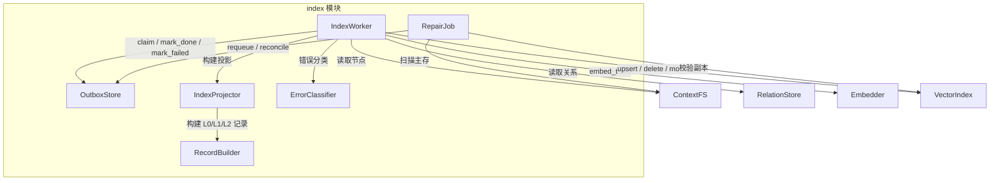
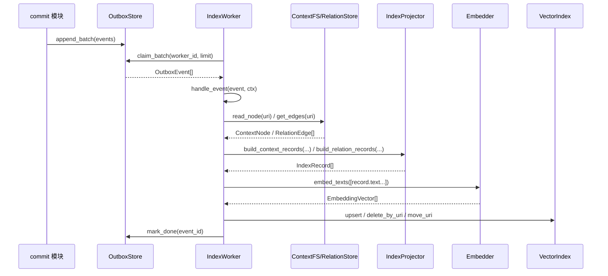
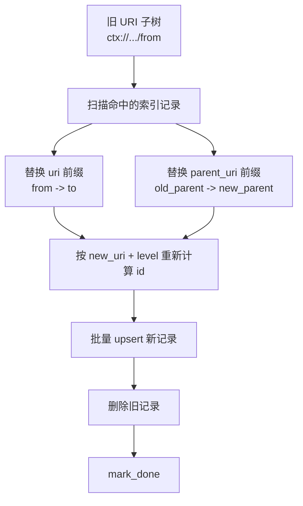

# ContextEngine Index 模块详细设计（index.md）

> 目标：基于 `ce_architecture.md` 的 7/10.6/11.2，给出可直接生成代码的索引模块实现设计。  
> 对齐原则：保持 OpenViking 的实现风格（稳定 ID、分层语义、异步队列/worker、可恢复最终一致），但按 ContextEngine 的对象与接口契约落地。

---

## 1. 模块职责与边界

### 1.1 职责

`index` 模块负责把 `ContextFS` 的主存节点异步投影到向量索引副本，保证：

1. 主存成功即 commit 成功（不阻塞写链路）。
2. 索引通过 Outbox 最终一致。
3. 事件可重放、可重试、可修复（repair）。
4. 事件处理幂等，可横向扩展多个 worker。

### 1.2 边界

- `index` **读取**：
  - `ContextFS`：节点三层文本与 metadata
  - `RelationStore`：关系边（用于 `UPSERT_RELATION`）
  - `OutboxStore`：待处理事件
- `index` **写入**：
  - `VectorIndex`：向量副本 upsert/delete/move
  - `OutboxStore`：事件状态变更（done/failed/retry）
- `index` **不负责**：
  - 主存事务提交（`commit` 模块）
  - 查询规划/检索编排（`retrieval` 模块）

### 1.3 模块概述（Module Overview）

1. 模块名称（唯一）：`ce.index`
2. 一句话职责：消费 Outbox 事件，把 `ContextFS` 主存异步投影为可检索的向量索引副本，并保证最终一致。
3. 外部依赖（建议实现）：
  - 存储：`ContextFS`、`RelationStore`、Outbox 持久层（SQL/KV）
  - 模型：`Embedder`（批量文本向量化）
  - 向量库：`VectorIndex` 适配器
  - 基础库：`hashlib/md5`、`datetime`、`json`、并发原语（线程池/async）
4. 与其他模块接口依赖：
  - `commit -> outbox.append_batch(...)`
  - `index worker -> fs/relation/vector/embedder`
  - `retrieval -> vector.search(...)`

### 1.4 输入/输出（I/O）

1. 输入（核心）：
  - `OutboxEvent[]`（`pending` 或过期 `claimed`）
  - `ContextNode`（来自 `ContextFS.read_node`）
  - `RelationEdge[]`（来自 `RelationStore.get_edges`）
2. 输入格式：
  - 事件与对象均为结构化对象；跨进程传输时使用 JSON。
3. 输出（核心）：
  - 向量索引写入副作用：`upsert/delete/move`
  - 事件状态更新：`done/retry_wait/dead`
  - 批次结果：`IndexBatchResult{claimed,succeeded,failed,retried}`
4. 输出格式：
  - 接口返回对象（内存）
  - 日志与监控指标（结构化文本 + metrics）

### 1.5 设计目标与约束（量化）

> 以下为 v1 推荐目标值，可按部署规模调整。

1. 性能目标：
  - `run_once(limit=100)`：p95 < 2s（不含外部 embedding/向量库长尾超时）
  - 单 worker 吞吐：>= 50 events/s（中等文本、批量 embedding 开启）
  - `claim_batch`：p95 < 50ms
2. 资源约束：
  - 单 worker 内存预算：<= 512MB
  - 批次内文本总长度上限：默认 1MB（超过拆批）
  - CPU 预算：默认 1~2 核可稳定运行
3. 一致性约束：
  - 主存成功即提交成功
  - 索引副本允许短暂落后，但可重试收敛到最终一致
  - 所有写操作必须幂等

### 1.6 架构图

#### 1.6.1 Index 模块在整体架构中的位置

```mermaid
flowchart LR
    A[commit 模块\nCommitCoordinator / ContextWriter / RelationWriter]
    B[OutboxStore\nappend / append_batch]
    C[index 模块\nIndexWorker / IndexProjector / RecordBuilder]
    D[ContextFS\nread_node / read_level / stat_node]
    E[RelationStore\nget_edges]
    F[Embedder\nembed_texts]
    G[VectorIndex\nupsert / delete_by_uri / move_uri]
    H[retrieval 模块\nL0Retriever / HierarchicalSearcher]

    A -->|登记 OutboxEvent| B
    B -->|claim_batch| C
    C -->|读取主存节点| D
    C -->|读取关系边| E
    C -->|文本向量化| F
    C -->|写入索引副本| G
    H -->|search(level=0/1/2)| G
```

#### 1.6.2 Index 模块内部组件关系



#### 1.6.3 ContextNode 到 IndexRecord 的投影关系

```mermaid
flowchart LR
    N[ContextNode\nuri / parent_uri / context_type / category\nabstract / overview / content / metadata]
    A0[".abstract.md"]
    A1[".overview.md"]
    A2["content.md"]
    R0[IndexRecord L0\nid=stable_hash(uri,0)]
    R1[IndexRecord L1\nid=stable_hash(uri,1)]
    R2[IndexRecord L2\nid=stable_hash(uri,2)]

    N --> A0
    N --> A1
    N --> A2
    A0 --> R0
    A1 --> R1
    A2 --> R2
```

#### 1.6.4 Outbox 到向量副本的处理主线



#### 1.6.5 MOVE_CONTEXT 的迁移语义图



---

## 2. 核心对象与数据结构

## 2.1 IndexRecord

```python
@dataclass
class IndexRecord:
    id: str
    uri: str
    parent_uri: str
    context_type: str
    category: str
    level: int              # 0(L0), 1(L1), 2(L2)
    text: str               # 该层用于 embedding 的原文
    filters: dict[str, Any] # 可过滤字段（扁平标量）
    metadata: dict[str, Any]
```

### 2.1.1 `IndexRecord.id = stable_hash(uri, level)` 规则（强制）

#### 规范输入（必须参与）

1. `canonical_uri`：规范化后的节点 URI（不带层级后缀文件名）。
2. `level`：`0|1|2` 整数。
3. `id_schema_version`：默认固定 `"v1"`（用于未来哈希策略升级）。

#### 不参与项（必须明确）

1. `node_version` / `updated_at` / `event_id` **不参与**（否则更新会产生新 ID，破坏 upsert 幂等）。
2. `text` **不参与**（同 URI 同 level 的内容更新应覆盖同一记录）。
3. `parent_uri/context_type/category` **不参与**（属性变更不应变更主键）。

#### 哈希输入串

```text
seed = "{id_schema_version}|{canonical_uri}|{level}"
id   = md5_hex(seed)   # 32位小写十六进制
```

> 说明：采用 MD5 是“确定性键”用途，不用于安全签名；风格与 OpenViking 当前实现保持一致。

#### URI 规范化（`canonical_uri`）

1. 去前后空白。
2. scheme 小写（`ctx://`）。
3. 移除末尾 `/`（根 URI 除外）。
4. 不拼接 `.abstract.md/.overview.md/content.md` 到 `uri` 字段；层级通过 `level` 表示。
5. 路径大小写保持原样（避免跨平台语义漂移）。

## 2.2 L0/L1/L2 文本构建规则（`IndexRecord.text`）

节点目录结构：

```text
{node_uri}/
├── .abstract.md
├── .overview.md
├── content.md
├── .meta.json
└── .relations.json
```

### 2.2.1 构建规则

1. L0：读取 `.abstract.md`（缺失则降级到 `.overview.md` 前 N 字）。
2. L1：读取 `.overview.md`（缺失则降级到 `content.md` 摘要截断）。
3. L2：读取 `content.md`（缺失则空串；空串不写入 L2 记录）。

### 2.2.2 最小字段集合（filters / metadata）

`filters` 最小集合（必须可过滤）：

```json
{
  "uri": "ctx://...",
  "parent_uri": "ctx://...",
  "context_type": "memory|resource|skill|session",
  "category": "profile|preferences|entities|events|cases|patterns|skills|...",
  "level": 0,
  "owner_space": "user:xxx|agent:xxx|shared",
  "account_id": "acc_xxx"
}
```

`metadata` 最小集合（建议）：

```json
{
  "node_version": 12,
  "updated_at": "2026-03-14T10:00:00Z",
  "content_hash": "sha256:...",
  "source_files": [".abstract.md", ".overview.md", "content.md"],
  "tags": ["..."],
  "trace_id": "..."
}
```

## 2.3 OutboxEvent

```python
@dataclass
class OutboxEvent:
    event_id: str
    event_type: str               # UPSERT_CONTEXT/DELETE_CONTEXT/MOVE_CONTEXT/UPSERT_RELATION
    uri: str
    payload: dict[str, Any]
    status: str
    retry_count: int
    created_at: datetime
```

## 2.4 MoveProjection

```python
@dataclass
class MoveProjection:
    old_uri: str
    new_uri: str
    old_parent_uri: str
    new_parent_uri: str
```

### 2.4.1 实现层附加字段说明

为保持和 `ce_architecture.md` 的核心对象模型一致，`OutboxEvent` 与 `MoveProjection` 在公开契约中只保留最小必需字段。

如实现需要以下附加字段，应视为 `outbox_store` / `index_worker` 的内部持久化字段，而不是核心对象模型必选字段：

1. `max_retries`
2. `next_visible_at`
3. `claimed_by`
4. `claim_token`
5. `claimed_until`
6. `last_error`
7. `updated_at`
8. `recursive`
9. `affected_prefix`

## 2.5 字段约束（Data Constraints）

1. `IndexRecord.level`：仅允许 `0|1|2`。
2. `IndexRecord.id`：32位小写十六进制字符串（MD5）。
3. `OutboxEvent.event_type`：`UPSERT_CONTEXT|DELETE_CONTEXT|MOVE_CONTEXT|UPSERT_RELATION`。
4. `OutboxEvent.status`：`pending|claimed|retry_wait|done|failed|dead`。
5. `retry_count`：`>=0`；若实现层启用 `max_retries`，则应满足 `retry_count <= max_retries`。
6. `uri/parent_uri`：必须是 `ctx://` 逻辑 URI；禁止空白字符串。
7. `owner_space`：`user:*|agent:*|shared`（部署可扩展，但必须可过滤）。

## 2.6 示例数据（可直接用于测试）

### 2.6.1 IndexRecord 示例

```json
{
  "id": "d6f4749f66f26ea98f15f6f5f181669c",
  "uri": "ctx://acc1/users/u1/memories/preferences/theme",
  "parent_uri": "ctx://acc1/users/u1/memories/preferences",
  "context_type": "memory",
  "category": "preferences",
  "level": 0,
  "text": "用户偏好深色主题，并倾向简洁界面。",
  "filters": {
    "uri": "ctx://acc1/users/u1/memories/preferences/theme",
    "parent_uri": "ctx://acc1/users/u1/memories/preferences",
    "context_type": "memory",
    "category": "preferences",
    "level": 0,
    "owner_space": "user:u1",
    "account_id": "acc1"
  },
  "metadata": {
    "node_version": 12,
    "updated_at": "2026-03-14T10:00:00Z",
    "content_hash": "sha256:abc",
    "source_files": [".abstract.md"],
    "trace_id": "t-001"
  }
}
```

### 2.6.2 OutboxEvent 示例

```json
{
  "event_id": "evt-001",
  "event_type": "UPSERT_CONTEXT",
  "uri": "ctx://acc1/users/u1/memories/preferences/theme",
  "payload": {
    "event_version": 1,
    "uri": "ctx://acc1/users/u1/memories/preferences/theme",
    "expected_node_version": 12,
    "reason": "merge",
    "trace_id": "t-001"
  },
  "status": "pending",
  "retry_count": 0,
  "created_at": "2026-03-14T10:00:00Z"
}
```

---

## 3. Outbox 设计

## 3.1 事件类型与 payload

### 3.1.1 `UPSERT_CONTEXT`

```json
{
  "event_version": 1,
  "uri": "ctx://a/users/u/memories/preferences/theme",
  "expected_node_version": 12,
  "reason": "create|merge|append|repair",
  "trace_id": "..."
}
```

### 3.1.2 `DELETE_CONTEXT`

```json
{
  "event_version": 1,
  "uri": "ctx://a/users/u/memories/events/e123",
  "expected_deleted_version": 8,
  "recursive": false,
  "trace_id": "..."
}
```

### 3.1.3 `MOVE_CONTEXT`

```json
{
  "event_version": 1,
  "from_uri": "ctx://a/users/u/memories/entities/project-x",
  "to_uri": "ctx://a/users/u/memories/entities/project-y",
  "recursive": true,
  "old_parent_uri": "ctx://a/users/u/memories/entities",
  "new_parent_uri": "ctx://a/users/u/memories/entities",
  "trace_id": "..."
}
```

### 3.1.4 `UPSERT_RELATION`

```json
{
  "event_version": 1,
  "uri": "ctx://a/users/u/memories/cases/c1",
  "relation_version": 5,
  "mode": "replace",
  "trace_id": "..."
}
```

## 3.2 状态机

```text
pending -> claimed -> done
                |-> retry_wait -> pending
                |-> failed(不可重试) -> dead(超过最大重试或人工打标)
```

状态定义：

1. `pending`：待消费。
2. `claimed`：已被某 worker 抢占，租约有效期内。
3. `retry_wait`：失败后等待重试窗口。
4. `done`：处理完成（终态）。
5. `failed`：本次处理失败（中间态，通常马上转 `retry_wait` 或 `dead`）。
6. `dead`：超过 `max_retries` 或判定不可重试（终态，等待 repair）。

## 3.3 重试与死信策略

1. 默认 `max_retries=8`。
2. 退避：`min(base * 2^retry_count, max_backoff) + jitter`。
3. 错误分类：
  - 可重试：网络超时、限流、向量库暂不可用、租约冲突。
  - 不可重试：payload 缺字段、URI 非法、层级非法。
4. 达到 `max_retries` -> `dead`，由 repair job 扫描恢复。

## 3.4 OutboxStore 并发安全语义（关键）

### 3.4.1 `claim_batch(worker_id, limit)`

语义要求：

1. 同一事件在任意时刻最多被一个 worker claim。
2. claim 需原子写入：`status=claimed, claimed_by, claim_token, claimed_until`。
3. 可回收过期租约：`status=claimed && claimed_until < now` 的事件可再次 claim。

推荐实现：

1. SQL 存储：`SELECT ... FOR UPDATE SKIP LOCKED` + 批量 `UPDATE ... WHERE id IN (...)`。
2. KV 存储：CAS（compare-and-set）更新版本号。

### 3.4.2 `mark_done(event_id)`

语义要求：

1. 仅当前持有有效 claim 的 worker 可以 done。
2. 幂等：重复调用不报错（已 done 返回成功）。
3. 过期 claim 不应覆盖新 claim 的状态。
4. 若实现需要 `claim_token` / `claimed_by` 校验，应作为 `OutboxStore` 内部实现细节，不改变 `10.6` 的公开接口签名。

### 3.4.3 `mark_failed(event_id, error, retryable=True)`

语义要求：

1. 仅当前持有有效 claim 的 worker 可写失败结果。
2. `retryable=True` 且未超重试：转 `retry_wait` 并设置 `next_visible_at`。
3. `retryable=False` 或超重试：转 `dead`。
4. 记录 `last_error/error_code/retry_count` 用于观测和 repair。

### 3.4.4 租约/超时回收（可选但建议默认开启）

1. `lease_seconds` 默认 60s。
2. worker 处理长任务可在实现层心跳续租。
3. 无心跳且超时 -> 自动可回收，避免永久卡死。

---

## 4. IndexProjector 设计

## 4.1 职责

将主存对象（`ContextNode` / `RelationEdge[]`）投影为索引对象（`IndexRecord[]` / `RelationIndexRecord[]` / `MoveProjection`）。

## 4.2 `build_context_records(node)` 规则

1. 输入：完整 `ContextNode`（含 `abstract/overview/content/metadata`）。
2. 输出：最多 3 条记录（L0/L1/L2）。
3. 跳过规则：
  - 对应层文本为空则跳过该层。
  - 但至少应保留一层（通常 L0）。
4. 每条记录使用同一 `uri/parent_uri/context_type/category/owner_space/account_id`，仅 `level/text/id` 不同。

伪代码：

```python
def build_context_records(node: ContextNode) -> list[IndexRecord]:
    texts = {
        0: pick_l0(node.abstract, node.overview, node.content),
        1: pick_l1(node.overview, node.content),
        2: pick_l2(node.content),
    }
    records = []
    for level, text in texts.items():
        if not text:
            continue
        uri = canonicalize_uri(node.uri)
        records.append(IndexRecord(
            id=stable_hash(uri, level),
            uri=uri,
            parent_uri=canonicalize_uri(node.parent_uri or ""),
            context_type=node.context_type,
            category=node.category or "",
            level=level,
            text=text,
            filters=build_filters(node, level),
            metadata=build_metadata(node, level, text),
        ))
    return records
```

## 4.3 `build_relation_records(uri, edges)` 规则

1. relation 索引默认可选（`enable_relation_index=false` 时返回空）。
2. 每条关系边构造稳定 ID：`stable_hash(f"{from_uri}|{to_uri}|{relation_type}", 0)`。
3. 关系记录至少保留：`from_uri/to_uri/relation_type/weight/reason/account_id/owner_space`。

## 4.4 `build_move_records(from_uri, to_uri)` 规则

返回 `MoveProjection`，用于 `VectorIndex.move_uri`：

1. `old_uri/new_uri`：移动根节点 URI。
2. `old_parent_uri/new_parent_uri`：根节点父 URI。
3. 子树迁移是否递归处理属于 `IndexWorker/VectorIndex` 的实现策略，不属于 `MoveProjection` 核心字段。

---

## 5. IndexWorker 设计

## 5.1 `run_once(limit=100)` 完整流程（强制）

```text
claim -> 按事件分发 -> 读取 ContextFS/RelationStore
-> IndexProjector -> Embedder.embed_texts -> VectorIndex 写入 -> mark_done
```

### 5.1.1 详细步骤

1. `events = outbox.claim_batch(worker_id, limit)`。
2. 遍历事件：
  - `handle_event(event, ctx)`。
  - 成功 -> `mark_done(event_id)`。
  - 失败 -> `mark_failed(..., retryable=classify(err))`。
3. 汇总 `IndexBatchResult(claimed, succeeded, failed, retried)`。

## 5.2 事件分发逻辑

### 5.2.1 `UPSERT_CONTEXT`

1. `node = ContextFS.read_node(ctx, uri)`。
2. 若节点不存在：降级执行 `VectorIndex.delete_by_uri(uri)`（防止脏残留）。
3. `records = IndexProjector.build_context_records(node)`。
4. `vectors = Embedder.embed_texts([r.text])` 批量化。
5. `VectorIndex.upsert(records_with_vectors)`。

### 5.2.2 `DELETE_CONTEXT`

1. 可选防误删：先 `ContextFS.exists(uri)`。
2. 若仍存在且版本更新，判定为陈旧删除事件，直接 `mark_done`（不删索引）。
3. 否则 `VectorIndex.delete_by_uri(uri)`（含各层记录）。

### 5.2.3 `MOVE_CONTEXT`

1. `projection = IndexProjector.build_move_records(from_uri, to_uri)`。
2. `VectorIndex.move_uri(from_uri, to_uri)`。
3. 若向量库不支持原地 move：`scan old -> rekey upsert new -> delete old`。

### 5.2.4 `UPSERT_RELATION`

1. `edges = RelationStore.get_edges(ctx, uri)`。
2. `records = IndexProjector.build_relation_records(uri, edges)`。
3. 通过可选的关系副本 provider 同步 `records`；若未开启关系副本则直接跳过。

## 5.3 每步失败时的最终一致保证

1. **claim 后进程崩溃**：租约过期后被重新 claim。
2. **embed 失败**：事件重试，主存不受影响。
3. **vector upsert 成功但 mark_done 失败**：事件会重试；由于 `id=stable_hash(uri, level)`，重复 upsert 为覆盖写，幂等成立。
4. **delete 重试**：重复 delete 为 no-op，幂等。
5. **move 重试**：`move_uri` 需设计为幂等（源不存在且目标已存在视为成功）。

## 5.4 核心伪代码（含分支与循环）

```python
def run_once(limit: int = 100) -> IndexBatchResult:
    result = IndexBatchResult(claimed=0, succeeded=0, failed=0, retried=0)
    events = outbox.claim_batch(worker_id=self.worker_id, limit=limit)
    result.claimed = len(events)

    for event in events:  # 循环处理批次事件
        try:
            handle_event(event, ctx)
            outbox.mark_done(event.event_id)
            result.succeeded += 1
        except RetryableIndexError as e:
            outbox.mark_failed(
                event.event_id,
                error=str(e),
                retryable=True,
            )
            result.retried += 1
        except NonRetryableIndexError as e:
            outbox.mark_failed(
                event.event_id,
                error=str(e),
                retryable=False,
            )
            result.failed += 1
        except Exception as e:
            # 未知错误默认按可重试处理，避免消息丢失
            outbox.mark_failed(
                event.event_id,
                error=f"unknown:{e}",
                retryable=True,
            )
            result.retried += 1
    return result
```

## 5.5 算法细节与边界情况

1. 条件分支：
  - `UPSERT_CONTEXT`：节点不存在时降级为 `delete_by_uri`。
  - `DELETE_CONTEXT`：若主存已出现更高版本节点，判定为陈旧删除事件并忽略删除。
  - `MOVE_CONTEXT`：若 `from_uri == to_uri`，直接幂等成功。
2. 循环逻辑：
  - 批次事件按 claim 顺序遍历。
  - embedding 与 upsert 可在事件内做子批处理循环（按 `batch_size` 分片）。
3. 边界情况：
  - 空文本：对应层记录跳过，不调用 embedding。
  - 超长文本：按 token/字节分段或截断（配置驱动）。
  - 非法 level：直接抛 `NonRetryableIndexError`。
4. 模块内部状态管理：
  - 业务状态以 Outbox 状态机为准（无本地内存状态机依赖）。
  - worker 仅持有短期运行态：`worker_id`、`inflight_count`、心跳续租计时器。
  - 缓存策略（可选）：`uri -> node_stat/version` 的短 TTL 缓存，用于减少重复读。

---

## 6. VectorIndex 适配设计

## 6.1 必选接口（对齐 10.6）

```python
class VectorIndex(Protocol):
    def upsert(self, records: list[IndexRecordWithVector]) -> None: ...
    def delete_by_uri(self, uri: str) -> None: ...
    def move_uri(self, from_uri: str, to_uri: str) -> None: ...
    def search(
        self,
        query_vector: list[float],
        filters: dict[str, Any],
        top_k: int,
        level: int = 0,
    ) -> list[VectorHit]: ...
```

## 6.2 可选扩展接口

```python
class VectorIndex(Protocol):
    def upsert_relations(self, records: list[RelationIndexRecord]) -> None: ...
    def delete_relations_by_uri(self, uri: str) -> int: ...
```

## 6.3 `move_uri(from_uri, to_uri)` 语义（强制）

### 6.3.1 语义目标

1. 更新所有 `uri` 以 `from_uri` 前缀开头的记录为 `to_uri` 前缀。
2. 同步更新 `parent_uri`：
  - 根节点：`parent_uri = parent(to_uri)`。
  - 子节点：`parent_uri` 也做前缀替换。
3. 重新计算每条记录 ID：`new_id = stable_hash(new_uri, level)`。

### 6.3.2 实现策略

1. 扫描命中集合（按前缀过滤）。
2. 对每条记录生成新记录（URI/parent_uri/filters/id 更新，向量保持不变）。
3. 批量 upsert 新记录。
4. 批量删除旧 ID（或旧 URI）。
5. 全流程可重入：若已迁移过，再执行应视为成功且不抛异常。

---

## 7. 幂等与一致性

## 7.1 幂等不变量

1. `UPSERT_CONTEXT`：同 `uri+level` 永远映射同 `id`。
2. `DELETE_CONTEXT`：可重复执行，删除不存在记录不报错。
3. `MOVE_CONTEXT`：重复执行不产生额外副作用。
4. `mark_done/mark_failed`：重复调用不应破坏最终状态；若实现层启用租约校验，应防止过期 worker 误写状态。

## 7.2 一致性策略（最终一致）

1. 主存是 source of truth。
2. 索引是可重建副本。
3. worker 处理时尽量读“当前主存状态”，天然吸收乱序事件影响。

### 7.2.1 乱序场景处理

1. `DELETE` 先于旧 `UPSERT` 到达：`UPSERT` 时发现节点不存在，执行 delete 收敛。
2. `UPSERT` 先于 `MOVE` 到达：`MOVE` 会重写 URI 映射，最终收敛。
3. `MOVE` 后又来旧 `UPSERT(from_uri)`：读取主存发现 `from_uri` 不存在，转 delete 或忽略，最终收敛到 `to_uri`。

---

## 8. 失败重试与 repair

## 8.1 错误分类

1. `RetryableError`：超时、限流、临时网络故障、租约冲突、向量库 5xx。
2. `NonRetryableError`：参数校验失败、URI 非法、事件类型不支持、数据损坏。

## 8.2 重试参数

```yaml
index:
  outbox:
    max_retries: 8
    retry_base_seconds: 2
    retry_max_seconds: 300
    retry_jitter_ratio: 0.2
```

## 8.3 dead-letter 与 repair job

### 8.3.1 Dead-letter

事件进入 `dead` 条件：

1. `retry_count >= max_retries`。
2. `retryable=False` 的不可恢复错误。

### 8.3.2 Repair Job（建议实现两类）

1. `repair_dead_events`：
  - 扫描 `status=dead` 事件。
  - 支持 `requeue`（重置为 `pending`）和 `force_done`（人工确认）。
2. `repair_reconcile_index`：
  - 扫描 `ContextFS` 全量或增量 URI。
  - 对比索引缺失/多余记录，自动补发 `UPSERT_CONTEXT/DELETE_CONTEXT` 事件。

## 8.4 错误处理矩阵（Error Handling）

| 错误类型 | 典型触发条件 | 处理策略 |
|---|---|---|
| `EmbedTimeoutError` | embedding 请求超时 | `mark_failed(retryable=True)`，指数退避 |
| `EmbedRateLimitError` | embedding 限流 | `retryable=True`，并触发降速/降并发 |
| `VectorIndexUnavailableError` | 向量库不可用/5xx | `retryable=True` |
| `VectorSchemaMismatchError` | 字段缺失或类型不匹配 | `retryable=False`，进入 dead |
| `InvalidUriError` | URI 非法或不可解析 | `retryable=False` |
| `OutboxClaimConflictError` | claim_token 冲突或租约失效 | 记录告警，当前事件按失败重试 |
| `ContextNotFoundError` | UPSERT 时主存节点缺失 | 降级 `delete_by_uri` 后 `done` |
| `UnknownError` | 未分类异常 | 默认 `retryable=True`，防止消息丢失 |

---

## 9. 并发模型与性能

## 9.1 并发模型

1. 多 worker 并行，Outbox claim 去重。
2. 单 worker 内可批处理 embedding 与 upsert。
3. 避免同事件并发：依赖 claim + lease + token。

## 9.2 性能建议

1. `claim_batch` 默认 100（可配置）。
2. `embed_batch_size` 默认 32（按模型吞吐调优）。
3. `vector_upsert_batch_size` 默认 128。
4. 对同 URI 的多事件可做“批内压缩”：
  - `UPSERT + UPSERT` 合并为最后一个。
  - `UPSERT + DELETE` 合并为 `DELETE`。
  - `MOVE + UPSERT(old_uri)` 转换为 `UPSERT(new_uri)`。

## 9.3 背压策略

1. 当 embedder/vector 延迟升高时降低 batch。
2. 当 outbox 堆积超阈值时提高 worker 副本数。
3. 设 `max_inflight_events` 防止内存失控。

---

## 10. 关键时序

## 10.1 UPSERT_CONTEXT

```text
IndexWorker.run_once
  -> OutboxStore.claim_batch
  -> handle_event(UPSERT_CONTEXT)
    -> ContextFS.read_node
    -> IndexProjector.build_context_records
    -> Embedder.embed_texts
    -> VectorIndex.upsert
  -> OutboxStore.mark_done
```

## 10.2 DELETE_CONTEXT

```text
IndexWorker.run_once
  -> claim_batch
  -> handle_event(DELETE_CONTEXT)
    -> ContextFS.exists (optional anti-stale check)
    -> VectorIndex.delete_by_uri
  -> mark_done
```

## 10.3 MOVE_CONTEXT

```text
IndexWorker.run_once
  -> claim_batch
  -> handle_event(MOVE_CONTEXT)
    -> IndexProjector.build_move_records
    -> VectorIndex.move_uri(from_uri, to_uri)
       (update uri + parent_uri + id rekey)
  -> mark_done
```

## 10.4 UPSERT_RELATION

```text
IndexWorker.run_once
  -> claim_batch
  -> handle_event(UPSERT_RELATION)
    -> RelationStore.get_edges
    -> IndexProjector.build_relation_records
    -> relation index adapter / optional provider sync
  -> mark_done
```

---

## 11. 接口定义（可直接映射代码）

> 与 `10.6 Index API` 保持一致，并补齐参数/返回/错误。

## 11.1 OutboxStore

```python
class OutboxStore(Protocol):
    def append(self, event: OutboxEventCreate) -> OutboxEvent: ...
    def append_batch(self, events: list[OutboxEventCreate]) -> list[OutboxEvent]: ...

    def claim_batch(self, worker_id: str, limit: int) -> list[OutboxEvent]: ...
    def mark_done(self, event_id: str) -> None: ...
    def mark_failed(self, event_id: str, error: str, retryable: bool = True) -> None: ...
```

错误：

- `OutboxClaimConflictError`
- `OutboxEventNotFoundError`
- `OutboxStateTransitionError`
- `OutboxStorageError`

实现说明：

1. 若实现需要 `lease_seconds / claim_token / claimed_by / next_visible_at`，可作为 `outbox_store_sql.py` 等实现层的私有字段或私有方法。
2. 对外暴露的核心契约保持与 `ce_architecture.md` 的 `10.6 Index API` 一致。

## 11.2 IndexProjector

```python
class IndexProjector(Protocol):
    def build_context_records(self, node: ContextNode) -> list[IndexRecord]: ...
    def build_relation_records(
        self,
        uri: str,
        edges: list[RelationEdge],
    ) -> list[RelationIndexRecord]: ...
    def build_move_records(self, from_uri: str, to_uri: str) -> MoveProjection: ...
```

错误：

- `InvalidNodeError`
- `InvalidUriError`
- `ProjectionError`

## 11.3 Embedder

```python
class Embedder(Protocol):
    def embed_texts(
        self,
        texts: list[str],
        model: str | None = None,
        timeout_seconds: int | None = None,
    ) -> list[EmbeddingVector]: ...
```

错误：

- `EmbedTimeoutError`
- `EmbedRateLimitError`
- `EmbedProviderError`

## 11.4 VectorIndex

```python
class VectorIndex(Protocol):
    def upsert(self, records: list[IndexRecordWithVector]) -> None: ...
    def delete_by_uri(self, uri: str) -> None: ...
    def move_uri(self, from_uri: str, to_uri: str) -> None: ...
    def search(
        self,
        query_vector: list[float],
        filters: dict[str, Any],
        top_k: int,
        level: int = 0,
    ) -> list[VectorHit]: ...
```

错误：

- `VectorIndexUnavailableError`
- `VectorWriteConflictError`
- `VectorSchemaMismatchError`
- `VectorQueryError`

实现说明：

1. `upsert_relations(...)`、递归删除、迁移统计等可作为实现层扩展能力，不纳入 `10.6` 的核心公共接口。
2. `MOVE_CONTEXT` 所需的递归 URI 迁移逻辑由 `VectorIndex.move_uri(from_uri, to_uri)` 的实现自行完成。

## 11.5 IndexWorker

```python
class IndexWorker:
    def __init__(
        self,
        worker_id: str,
        outbox: OutboxStore,
        context_fs: ContextFS,
        relation_store: RelationStore,
        projector: IndexProjector,
        embedder: Embedder,
        vector_index: VectorIndex,
        config: IndexWorkerConfig,
        logger: Logger,
    ) -> None: ...

    def run_once(self, limit: int = 100) -> IndexBatchResult: ...
    def handle_event(self, event: OutboxEvent, ctx: RequestContext) -> None: ...
```

错误（`handle_event` 抛出，由 `run_once` 分类）：

- `RetryableIndexError`
- `NonRetryableIndexError`

## 11.6 事件/回调约定

1. 模块内事件源：Outbox 事件（非实时回调协议，采用轮询 claim）。
2. 可选回调钩子（便于测试与观测）：
  - `on_event_start(event: OutboxEvent) -> None`
  - `on_event_success(event: OutboxEvent, latency_ms: int) -> None`
  - `on_event_failure(event: OutboxEvent, error: Exception, retryable: bool) -> None`
3. 约束：
  - 回调异常不得影响主流程；必须吞掉并记日志。
  - 回调应为“旁路”行为，不得写主存。

## 11.7 接口示例（便于 Agent 生成代码）

```python
# 1) worker 拉取并处理一轮
worker = IndexWorker(
    worker_id="index-worker-1",
    outbox=outbox_store,
    context_fs=context_fs,
    relation_store=relation_store,
    projector=index_projector,
    embedder=embedder,
    vector_index=vector_index,
    config=IndexWorkerConfig(claim_limit=100),
    logger=logger,
)
batch = worker.run_once(limit=100)

# 2) 事件写入（commit 侧）
outbox_store.append_batch([
    OutboxEventCreate(
        event_type="UPSERT_CONTEXT",
        uri="ctx://acc1/users/u1/memories/preferences/theme",
        payload={"event_version": 1, "uri": "ctx://acc1/users/u1/memories/preferences/theme"},
    )
])
```

---

## 12. 配置项与可观测性

## 12.1 配置项建议

```yaml
index:
  worker:
    enabled: true
    poll_interval_ms: 500
    claim_limit: 100
    lease_seconds: 60
    heartbeat_seconds: 20
    max_inflight_events: 200
  outbox:
    max_retries: 8
    retry_base_seconds: 2
    retry_max_seconds: 300
    retry_jitter_ratio: 0.2
    dead_letter_enabled: true
  embedding:
    model: "text-embedding-3-large"
    batch_size: 32
    timeout_seconds: 30
  vector:
    upsert_batch_size: 128
    relation_index_enabled: false
  repair:
    dead_event_scan_interval_minutes: 10
    reconcile_interval_minutes: 60
```

## 12.2 指标（Metrics）

1. `index_outbox_pending_total`
2. `index_outbox_claimed_total`
3. `index_outbox_dead_total`
4. `index_worker_run_once_latency_ms`
5. `index_worker_event_success_total{event_type}`
6. `index_worker_event_failed_total{event_type,error_code}`
7. `index_embed_latency_ms`
8. `index_vector_upsert_latency_ms`
9. `index_repair_requeued_total`

## 12.3 日志与追踪

1. 日志字段最小集：`trace_id,event_id,event_type,uri,worker_id,retry_count`。
2. 若实现层启用租约/claim token，可作为附加日志字段输出。
3. 对每个事件输出 `start/success/fail` 三类结构化日志。
4. Trace span 建议：
  - `index.claim_batch`
  - `index.handle_event`
  - `index.embed`
  - `index.vector_write`
  - `index.outbox_mark_done`

## 12.4 参数范围与行为影响

| 参数 | 默认值 | 建议范围 | 影响 |
|---|---:|---:|---|
| `worker.claim_limit` | 100 | 10~500 | 越大吞吐越高，但单轮延迟与内存占用上升 |
| `worker.lease_seconds` | 60 | 15~300 | 过短易误回收，过长影响故障恢复速度 |
| `outbox.max_retries` | 8 | 3~20 | 越大越不易丢事件，但死信收敛更慢 |
| `outbox.retry_base_seconds` | 2 | 1~10 | 初始重试速度 |
| `outbox.retry_max_seconds` | 300 | 30~1800 | 长尾失败的最大等待 |
| `embedding.batch_size` | 32 | 8~128 | 影响 embedding 吞吐与超时风险 |
| `embedding.timeout_seconds` | 30 | 5~120 | 过小易误超时，过大拖慢失败反馈 |
| `vector.upsert_batch_size` | 128 | 16~512 | 影响写入吞吐与事务大小 |
| `worker.max_inflight_events` | 200 | 50~2000 | 并发上限，受内存与下游容量限制 |

---

## 13. 测试策略

## 13.1 单元测试

1. `stable_hash`：同输入恒定、不同 level 不同 ID、URI 规范化一致。
2. `build_context_records`：L0/L1/L2 构建与降级逻辑。
3. `OutboxStore` 状态迁移：`pending->claimed->done`、重试与 dead。
4. `move_uri`：`uri/parent_uri/id` 同步迁移与幂等。

## 13.2 集成测试

1. `run_once` 成功链路：claim 到 done 全流程。
2. embed 失败重试：验证 backoff 与最终 done。
3. vector 写成功但 mark_done 失败：重复 upsert 不重复脏数据。
4. 并发 claim：多 worker 下事件不重复消费。
5. 租约超时回收：worker 崩溃后事件可继续处理。

## 13.3 端到端测试

1. commit 产生 outbox -> worker 索引 -> search 可召回。
2. delete/move 后索引一致性验证。
3. dead-letter + repair requeue 后恢复。

## 13.4 可靠性测试（建议）

1. 故障注入：embedder 超时、vector 5xx、outbox DB 暂时不可用。
2. 压测：高并发 append + 多 worker 消费。
3. 恢复：进程重启/宕机后数据不丢失、可继续消费。

## 13.5 可直接生成单元测试的样例数据

### 13.5.1 `stable_hash` 用例

```json
[
  {
    "name": "same_input_same_id",
    "input": {"uri": "ctx://acc1/users/u1/memories/preferences/theme", "level": 0},
    "expect": {"equal_to_case": "same_input_same_id_repeat"}
  },
  {
    "name": "same_input_same_id_repeat",
    "input": {"uri": "ctx://acc1/users/u1/memories/preferences/theme", "level": 0},
    "expect": {"id_non_empty": true}
  },
  {
    "name": "different_level_different_id",
    "input": {"uri": "ctx://acc1/users/u1/memories/preferences/theme", "level": 1},
    "expect": {"not_equal_to_case": "same_input_same_id"}
  }
]
```

### 13.5.2 `build_context_records` 输入输出

```json
{
  "node": {
    "uri": "ctx://acc1/users/u1/memories/preferences/theme",
    "parent_uri": "ctx://acc1/users/u1/memories/preferences",
    "context_type": "memory",
    "category": "preferences",
    "owner_space": "user:u1",
    "account_id": "acc1",
    "abstract": "用户偏好深色主题。",
    "overview": "用户在多个会话中明确偏好深色主题，且不喜欢高亮背景。",
    "content": "原始内容...",
    "metadata": {"node_version": 12}
  },
  "expect": {
    "record_count": 3,
    "levels": [0, 1, 2],
    "all_have_fields": ["id", "uri", "parent_uri", "context_type", "category", "level", "text", "filters", "metadata"]
  }
}
```

### 13.5.3 边界/异常用例

1. `abstract/overview/content` 全空：期望 `record_count=0`，并产生可观测 warning。
2. 非法 `level=9`：期望抛出 `NonRetryableIndexError`。
3. 若实现层启用租约校验：过期 claim 不得成功执行 `mark_done`。
4. `MOVE_CONTEXT from_uri==to_uri`：期望直接成功且不抛异常。

---

## 14. 建议目录结构（可直接映射到代码文件/类）

```text
src/
  index/
    __init__.py
    types.py                    # IndexRecord/OutboxEvent/MoveProjection/IndexBatchResult
    stable_hash.py              # canonicalize_uri + stable_hash
    record_builder.py           # L0/L1/L2 text构建 + filters/metadata
    index_projector.py          # IndexProjectorImpl
    outbox_store.py             # OutboxStore协议
    outbox_store_sql.py         # SQL实现(含claim/lease/CAS)
    index_worker.py             # IndexWorker.run_once/handle_event
    error_classifier.py         # retryable/non-retryable分类
    repair_job.py               # dead-letter重放 + reconcile
    vector_index_adapter.py     # VectorIndex实现适配
    relation_index_adapter.py   # (可选)关系副本适配
    metrics.py                  # 指标定义
```

建议类与关键方法：

1. `StableHash`  
  - `canonicalize_uri(uri: str) -> str`  
  - `stable_hash(uri: str, level: int, id_schema_version: str = "v1") -> str`

2. `RecordBuilder`  
  - `build_level_texts(node: ContextNode) -> dict[int, str]`  
  - `build_filters(node: ContextNode, level: int) -> dict[str, Any]`  
  - `build_metadata(node: ContextNode, level: int, text: str) -> dict[str, Any]`

3. `IndexProjectorImpl`  
  - `build_context_records(node: ContextNode) -> list[IndexRecord]`  
  - `build_relation_records(uri: str, edges: list[RelationEdge]) -> list[RelationIndexRecord]`  
  - `build_move_records(from_uri: str, to_uri: str) -> MoveProjection`

4. `SqlOutboxStore`  
  - `claim_batch(worker_id: str, limit: int) -> list[OutboxEvent]`  
  - `mark_done(event_id: str) -> None`  
  - `mark_failed(event_id: str, error: str, retryable: bool = True) -> None`  
  - `_extend_lease(...)-> bool  # 可选私有实现细节`

5. `IndexWorker`  
  - `run_once(limit: int = 100) -> IndexBatchResult`  
  - `handle_event(event: OutboxEvent, ctx: RequestContext) -> None`  
  - `_handle_upsert_context(...) -> None`  
  - `_handle_delete_context(...) -> None`  
  - `_handle_move_context(...) -> None`  
  - `_handle_upsert_relation(...) -> None`

6. `VectorIndexAdapter`  
  - `upsert(records: list[IndexRecordWithVector]) -> None`  
  - `delete_by_uri(uri: str) -> None`  
  - `move_uri(from_uri: str, to_uri: str) -> None`  
  - `search(query_vector: list[float], filters: dict[str, Any], top_k: int, level: int = 0) -> list[VectorHit]`

---

## 15. 默认实现决策（v1）

1. `id_schema_version` 固定 `v1`，hash 算法 `md5`。
2. `MOVE_CONTEXT` 默认 `recursive=true`。
3. `UPSERT_RELATION` 默认开启事件写入，关系向量索引默认关闭（可配置开启）。
4. worker 以同步接口建模，内部可用 async 并行 embedding/vector 写入。

## 16. 覆盖对照（对应评审清单）

| 评审项 | 覆盖位置 |
|---|---|
| 1. 模块概述（名称/职责/依赖/I/O/目标约束） | `1.3/1.4/1.5` |
| 2. 接口定义（参数/返回/异常/事件/示例） | `11.1~11.7` |
| 3. 数据结构（定义/字段/约束/示例） | `2.1~2.6` |
| 4. 逻辑与算法（流程/分支/循环/状态） | `5.1~5.5`、`10.1~10.4` |
| 5. 错误处理（类型/触发/策略） | `8.1`、`8.4` |
| 6. 配置参数（默认/影响/范围约束） | `12.1`、`12.4` |
| 7. 测试指导（测试点/样例/边界异常） | `13.1~13.5` |
