# ContextEngine 多租户能力设计文档

> 版本：v1.0  
> 基于：`ce_architecture.md` 多租架构细化文档  
> 参考：OpenViking/OpenClaw 多租户设计最佳实践

## 1. 概述

本文档详细定义 ContextEngine 的多租户能力实现，包括架构设计、接口规范、数据隔离策略和实现指南。设计目标是构建一套"企业账户隔离 + 用户/Agent 双层空间 + 文件主存 + 异步索引副本"的统一多租户架构。

### 1.1 设计原则

| 原则 | 说明 |
|------|------|
| 身份先行 | 所有数据面操作必须携带 `RequestContext`，身份由 API Key 解析 |
| 账户隔离 | 不同 `account` 之间主存、索引、元数据完全隔离 |
| 空间清晰 | 同一账户下区分 `user_space`、`agent_space`、`shared_space` |
| 最小权限 | 用户只能访问自己的空间及账户共享资源 |
| 上下文传递 | `RequestContext` 贯穿全链路，不允许组件自行猜测租户 |

### 1.2 核心能力矩阵

| 能力 | ROOT | ADMIN | USER |
|------|------|-------|------|
| 创建/删除账户 | ✓ | ✗ | ✗ |
| 提升用户角色 | ✓ | ✗ | ✗ |
| 注册/移除用户 | ✓ | ✓（本账户） | ✗ |
| 下发/重置密钥 | ✓ | ✓（本账户） | ✗ |
| 读写自有空间 | ✓ | ✓ | ✓ |
| 跨账户访问 | ✓ | ✗ | ✗ |
| 账户共享资源访问 | ✓ | ✓ | ✓ |
| 向量检索 | ✓（全局） | ✓（本账户） | ✓（本账户） |

---

## 2. 架构设计

### 2.1 总体架构

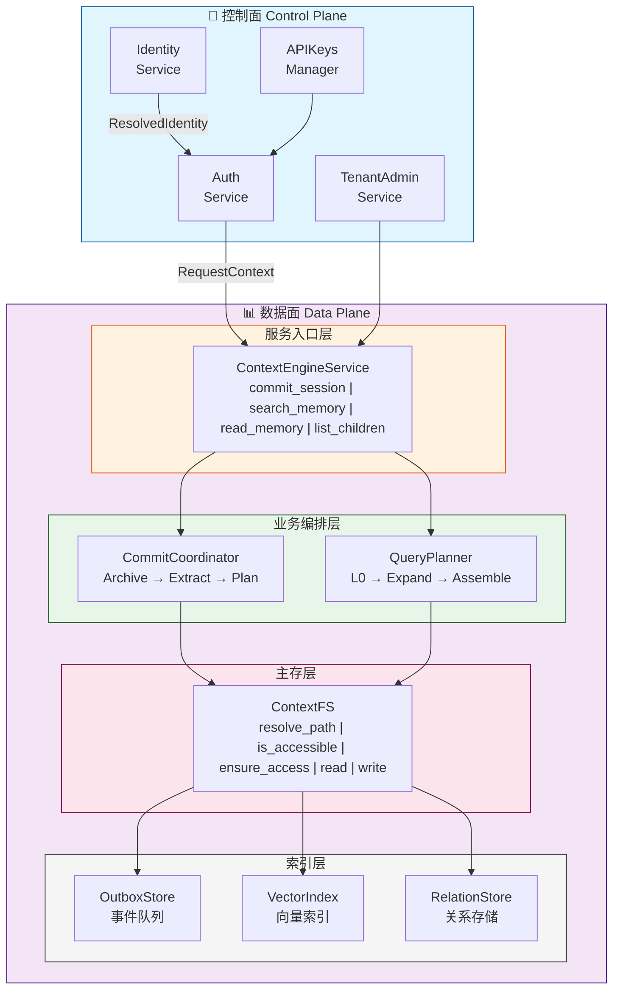

### 2.2 请求上下文传递链路

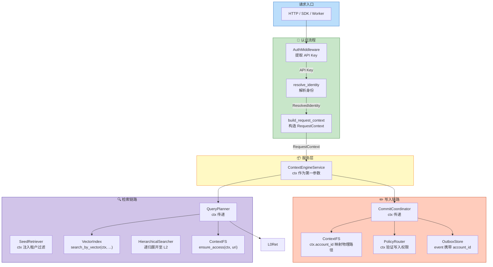

### 2.3 三维隔离模型

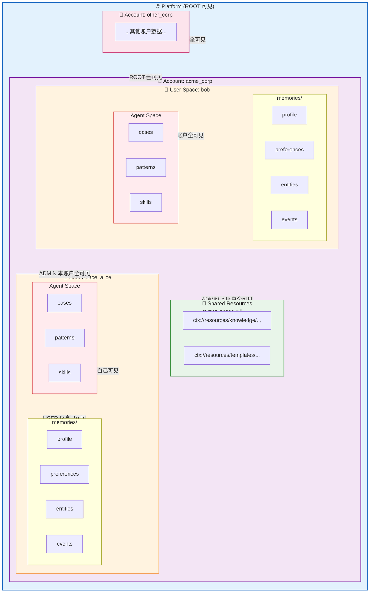

### 2.4 数据流向概览

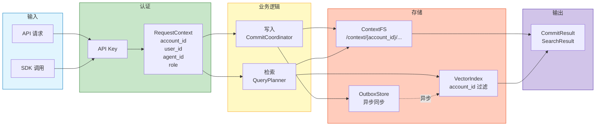

---

## 3. 身份与认证模型

### 3.0 RBAC 权限模型图

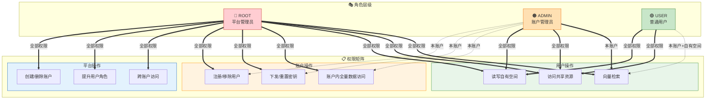

### 3.1 核心类型定义

```python
from enum import Enum
from dataclasses import dataclass
from typing import Optional

class Role(str, Enum):
    """角色枚举 - 三层权限模型"""
    ROOT = "root"      # 平台管理员：一切权限
    ADMIN = "admin"    # 账户管理员：账户内管理权限
    USER = "user"      # 普通用户：自有空间读写权限

@dataclass
class UserIdentifier:
    """用户/Agent 标识符 - 三元组"""
    account_id: str    # 所属账户
    user_id: str       # 用户 ID
    agent_id: str      # Agent ID（默认 "default"）
    
    def user_space_name(self) -> str:
        """用户级空间名，不含 agent_id"""
        import hashlib
        return f"{self.account_id}_{hashlib.md5(self.user_id.encode()).hexdigest()[:8]}"
    
    def agent_space_name(self) -> str:
        """Agent 级空间名，由 user_id + agent_id 共同决定"""
        import hashlib
        return hashlib.md5((self.user_id + self.agent_id).encode()).hexdigest()[:12]

@dataclass
class ResolvedIdentity:
    """API Key 解析结果 - 认证中间件输出"""
    role: Role
    account_id: Optional[str] = None  # ROOT 可能无 account_id
    user_id: Optional[str] = None     # ROOT 可能无 user_id
    agent_id: Optional[str] = None    # 来自 X-Agent-ID header

@dataclass
class RequestContext:
    """请求级租户上下文 - 贯穿全链路"""
    user: UserIdentifier              # 完整三元组
    role: Role                        # 当前角色
    session_id: Optional[str] = None  # 会话 ID
    trace_id: Optional[str] = None    # 追踪 ID
    
    @property
    def account_id(self) -> str:
        return self.user.account_id
    
    @property
    def user_space(self) -> str:
        return self.user.user_space_name()
    
    @property
    def agent_space(self) -> str:
        return self.user.agent_space_name()
```

### 3.2 API Key 管理

#### 3.2.1 两层 Key 结构

| 类型 | 格式 | 解析结果 | 存储位置 |
|------|------|----------|----------|
| Root Key | `secrets.token_hex(32)` | role=ROOT | 配置文件 |
| User Key | `secrets.token_hex(32)` | (account_id, user_id, role) | `/{account_id}/_system/users.json` |

#### 3.2.2 存储结构

```json
// /_system/accounts.json — 全局账户清单
{
    "accounts": {
        "default": { "created_at": "2026-03-14T00:00:00Z", "status": "active" },
        "acme_corp": { "created_at": "2026-03-14T10:00:00Z", "status": "active" }
    }
}

// /acme_corp/_system/users.json — 账户用户注册表
{
    "users": {
        "alice": { "role": "admin", "key": "7f3a9c1e...", "created_at": "..." },
        "bob": { "role": "user", "key": "d91f5b2a...", "created_at": "..." }
    }
}
```

#### 3.2.3 APIKeyManager 接口

```python
class APIKeyManager:
    """API Key 生命周期管理与解析"""
    
    def __init__(self, root_key: str, fs_root: str):
        """
        初始化密钥管理器
        
        Args:
            root_key: 平台 Root Key（来自配置文件）
            fs_root: 文件系统根目录
        """
        self._root_key = root_key
        self._fs_root = fs_root
        self._accounts: Dict[str, AccountInfo] = {}
        self._user_keys: Dict[str, UserKeyEntry] = {}  # key → identity
    
    async def load(self) -> None:
        """加载账户清单和用户密钥索引"""
        pass
    
    def resolve(self, api_key: str) -> ResolvedIdentity:
        """
        API Key 到身份映射
        
        解析顺序：
        1. HMAC 比对 root key → 匹配则 role=ROOT
        2. 查 user key 索引 → 匹配则得到 (account_id, user_id, role)
        3. 均不匹配 → raise UnauthenticatedError
        """
        pass
    
    async def create_account(self, account_id: str, admin_user_id: str) -> str:
        """
        创建账户并生成管理员密钥
        
        Args:
            account_id: 账户 ID（唯一标识）
            admin_user_id: 首个管理员用户 ID
            
        Returns:
            管理员的 user key
        """
        pass
    
    async def delete_account(self, account_id: str) -> None:
        """删除账户元数据（数据级联清理由调用方负责）"""
        pass
    
    async def register_user(
        self, 
        account_id: str, 
        user_id: str, 
        role: str = "user"
    ) -> str:
        """
        注册账户用户
        
        Returns:
            新用户的 user key
        """
        pass
    
    async def remove_user(self, account_id: str, user_id: str) -> None:
        """删除账户用户（key 立即失效）"""
        pass
    
    async def regenerate_key(self, account_id: str, user_id: str) -> str:
        """轮换密钥（旧 key 立即失效）"""
        pass
    
    async def set_role(self, account_id: str, user_id: str, role: str) -> None:
        """修改用户角色（仅 ROOT 可调用）"""
        pass
    
    def get_accounts(self) -> List[AccountInfo]:
        """列出所有账户"""
        pass
    
    def get_users(self, account_id: str) -> List[UserInfo]:
        """列出账户用户"""
        pass
```

### 3.3 认证中间件

```python
class AuthService:
    """认证服务 - 身份解析与权限校验"""
    
    def __init__(self, key_manager: APIKeyManager):
        self._key_manager = key_manager
    
    async def resolve_identity(
        self,
        api_key: Optional[str] = None,
        authorization: Optional[str] = None,
        account_hint: Optional[str] = None,
        user_hint: Optional[str] = None,
        agent_hint: Optional[str] = None,
    ) -> ResolvedIdentity:
        """
        解析 API Key 与请求头，产出身份
        
        Args:
            api_key: X-API-Key header
            authorization: Authorization: Bearer header
            account_hint: X-Account-ID header（ROOT 可用）
            user_hint: X-User-ID header（ROOT 可用）
            agent_hint: X-Agent-ID header
            
        Returns:
            ResolvedIdentity
            
        Raises:
            UnauthenticatedError: 无效或缺失的 API Key
        """
        # 1. 提取 key
        key = api_key or self._extract_bearer(authorization)
        if not key:
            raise UnauthenticatedError("Missing API Key")
        
        # 2. 解析身份
        identity = self._key_manager.resolve(key)
        
        # 3. 处理 ROOT 的 hint 参数
        if identity.role == Role.ROOT:
            identity.account_id = account_hint or identity.account_id or "default"
            identity.user_id = user_hint or identity.user_id or "default"
        
        # 4. 设置 agent_id
        identity.agent_id = agent_hint or "default"
        
        return identity
    
    def build_request_context(
        self,
        identity: ResolvedIdentity,
        session_id: Optional[str] = None,
        trace_id: Optional[str] = None,
    ) -> RequestContext:
        """构造统一业务上下文"""
        return RequestContext(
            user=UserIdentifier(
                account_id=identity.account_id or "default",
                user_id=identity.user_id or "default",
                agent_id=identity.agent_id or "default",
            ),
            role=identity.role,
            session_id=session_id,
            trace_id=trace_id or self._generate_trace_id(),
        )
    
    def require_role(self, ctx: RequestContext, *allowed_roles: Role) -> None:
        """
        执行 RBAC 检查
        
        Raises:
            PermissionDeniedError: 角色不满足要求
        """
        if ctx.role not in allowed_roles:
            raise PermissionDeniedError(
                f"Operation requires role: {allowed_roles}, got: {ctx.role}"
            )
```

---

## 4. 存储模型与 URI 规范

### 4.1 逻辑 URI 规范

采用"账户不进逻辑 URI，只进 `RequestContext`"的设计，与 OpenViking 对齐。

| 类别 | URI 模式 | 说明 |
|------|----------|------|
| 共享资源 | `ctx://resources/{project}/{topic}` | 账户共享资源 |
| 用户画像 | `ctx://user/{user_space}/memories/profile` | 用户固定画像节点 |
| 用户偏好 | `ctx://user/{user_space}/memories/preferences/{slug}` | 按主题聚合 |
| 用户实体 | `ctx://user/{user_space}/memories/entities/{slug}` | 按实体聚合 |
| 用户事件 | `ctx://user/{user_space}/memories/events/{event_id}` | 追加型事件 |
| Agent 案例 | `ctx://agent/{agent_space}/memories/cases/{case_id}` | 追加型案例 |
| Agent 模式 | `ctx://agent/{agent_space}/memories/patterns/{slug}` | 聚合型模式 |
| Agent 技能 | `ctx://agent/{agent_space}/skills/{skill_name}` | Agent 私有技能 |
| 会话 | `ctx://session/{user_space}/{session_id}` | 会话与归档 |

### 4.2 物理路径映射

`ContextFS` 负责把逻辑 URI 映射到账户隔离的物理路径：

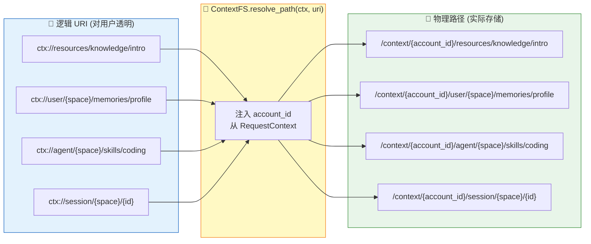

**映射规则说明：**

| 逻辑 URI | 物理路径 |
|----------|----------|
| `ctx://resources/knowledge/intro` | `/context/{account_id}/resources/knowledge/intro` |
| `ctx://user/{space}/memories/profile` | `/context/{account_id}/user/{space}/memories/profile` |
| `ctx://agent/{space}/skills/coding` | `/context/{account_id}/agent/{space}/skills/coding` |
| `ctx://session/{space}/{id}` | `/context/{account_id}/session/{space}/{id}` |

### 4.3 owner_space 规则

| context_type | owner_space | 说明 |
|--------------|-------------|------|
| `resource` | `""` 或显式共享子空间 | 当前账户共享资源 |
| `memory` | `user_space` 或 `agent_space` | 记忆隔离核心字段 |
| `skill` | `agent_space` | 技能随 Agent 隔离 |
| `session_archive` | `user_space` | 会话归档归属用户 |

### 4.4 可见性规则矩阵

| Scope | ROOT | ADMIN | USER |
|-------|------|-------|------|
| `ctx://resources/...` | 全可见 | 当前账户全可见 | 当前账户全可见 |
| `ctx://user/{user_space}/...` | 全可见 | 当前账户全可见 | 仅当前 `user_space` |
| `ctx://agent/{agent_space}/...` | 全可见 | 当前账户全可见 | 仅当前 `agent_space` |
| `ctx://session/{user_space}/{session_id}` | 全可见 | 当前账户全可见 | 仅当前 `user_space` |
| `ctx://_system/...` | 平台内部可见 | 不对业务层暴露 | 不可见 |

---

## 5. 核心接口实现

### 5.1 ContextFS 多租户接口

```python
class ContextFS:
    """上下文文件系统 - 多租户存储抽象"""
    
    def __init__(self, root_path: str):
        self._root = root_path
    
    # ================== 路径转换 ==================
    
    def resolve_path(self, ctx: RequestContext, uri: str) -> str:
        """
        逻辑 URI 到物理路径映射
        
        Args:
            ctx: 请求上下文（提供 account_id）
            uri: 逻辑 URI（ctx://...）
            
        Returns:
            物理路径 /context/{account_id}/...
        """
        remainder = uri[len("ctx://"):].strip("/")
        return os.path.join(self._root, ctx.account_id, remainder)
    
    def path_to_uri(self, ctx: RequestContext, path: str) -> str:
        """
        物理路径到逻辑 URI 逆映射
        
        去掉 account_id 前缀，返回给调用方的 URI 不含 account_id
        """
        prefix = os.path.join(self._root, ctx.account_id)
        if path.startswith(prefix):
            inner = path[len(prefix):].lstrip(os.sep)
            return f"ctx://{inner}"
        raise ValueError(f"Path not in account scope: {path}")
    
    def extract_space(self, uri: str) -> Optional[str]:
        """
        解析 URI 的 space 段
        
        Returns:
            - user_space 或 agent_space（若 URI 包含）
            - None（结构性目录如 ctx://resources）
        """
        parts = uri[len("ctx://"):].split("/")
        if len(parts) >= 2 and parts[0] in ("user", "agent", "session"):
            return parts[1]
        return None
    
    # ================== 访问控制 ==================
    
    def is_accessible(self, ctx: RequestContext, uri: str) -> bool:
        """
        判断租户可见性
        
        规则：
        1. ROOT/ADMIN 可访问当前账户所有资源
        2. USER 只能访问：
           - 共享资源（ctx://resources/...）
           - 自己的 user_space
           - 自己的 agent_space
        """
        if ctx.role in (Role.ROOT, Role.ADMIN):
            return True
        
        # 结构性目录（不含 space）允许遍历
        space_in_uri = self.extract_space(uri)
        if space_in_uri is None:
            return True
        
        # 含 space 的 URI 检查归属
        return space_in_uri in (ctx.user_space, ctx.agent_space)
    
    def ensure_access(self, ctx: RequestContext, uri: str) -> None:
        """
        读写前执行权限校验
        
        Raises:
            PermissionDeniedError: 无权访问
        """
        if not self.is_accessible(ctx, uri):
            raise PermissionDeniedError(
                f"Access denied: {uri} (space not owned by current user)"
            )
    
    # ================== 节点操作 ==================
    
    def exists(self, ctx: RequestContext, uri: str) -> bool:
        """判断节点是否存在"""
        self.ensure_access(ctx, uri)
        path = self.resolve_path(ctx, uri)
        return os.path.exists(path)
    
    async def write_node(self, ctx: RequestContext, node: ContextNode) -> None:
        """
        写完整目录节点
        
        目录结构：
        {node_dir}/
        ├── .abstract.md
        ├── .overview.md
        ├── content.md
        ├── .meta.json
        └── .relations.json
        """
        self.ensure_access(ctx, node.uri)
        path = self.resolve_path(ctx, node.uri)
        os.makedirs(path, exist_ok=True)
        
        # 写各层级文件
        self._write_file(os.path.join(path, ".abstract.md"), node.abstract)
        self._write_file(os.path.join(path, ".overview.md"), node.overview)
        self._write_file(os.path.join(path, "content.md"), node.content)
        self._write_json(os.path.join(path, ".meta.json"), node.metadata)
    
    async def read_node(
        self, 
        ctx: RequestContext, 
        uri: str, 
        include_content: bool = True
    ) -> ContextNode:
        """读完整节点"""
        self.ensure_access(ctx, uri)
        path = self.resolve_path(ctx, uri)
        
        return ContextNode(
            uri=uri,
            account_id=ctx.account_id,
            owner_space=self.extract_space(uri) or "",
            abstract=self._read_file(os.path.join(path, ".abstract.md")),
            overview=self._read_file(os.path.join(path, ".overview.md")),
            content=self._read_file(os.path.join(path, "content.md")) if include_content else "",
            metadata=self._read_json(os.path.join(path, ".meta.json")),
        )
    
    async def list_children(
        self, 
        ctx: RequestContext, 
        uri: str, 
        recursive: bool = False, 
        depth: int = 1
    ) -> List[NodeSummary]:
        """
        列当前租户可见子节点
        
        结果经过权限过滤，USER 只能看到自己有权限的节点
        """
        self.ensure_access(ctx, uri)
        path = self.resolve_path(ctx, uri)
        
        children = []
        for entry in os.listdir(path):
            child_path = os.path.join(path, entry)
            child_uri = self.path_to_uri(ctx, child_path)
            
            # 权限过滤
            if not self.is_accessible(ctx, child_uri):
                continue
            
            children.append(NodeSummary(
                uri=child_uri,
                name=entry,
                is_directory=os.path.isdir(child_path),
            ))
            
            # 递归
            if recursive and os.path.isdir(child_path) and depth > 1:
                children.extend(await self.list_children(
                    ctx, child_uri, recursive=True, depth=depth-1
                ))
        
        return children
    
    async def delete_node(
        self, 
        ctx: RequestContext, 
        uri: str, 
        recursive: bool = False
    ) -> None:
        """删除节点"""
        self.ensure_access(ctx, uri)
        path = self.resolve_path(ctx, uri)
        
        if recursive:
            shutil.rmtree(path)
        else:
            os.remove(path)
```

### 5.2 租户管理服务接口

```python
class TenantAdminService:
    """租户管理服务 - 账户/用户生命周期管理"""
    
    def __init__(
        self, 
        key_manager: APIKeyManager, 
        context_fs: ContextFS,
        vector_index: VectorIndex,
    ):
        self._key_manager = key_manager
        self._fs = context_fs
        self._vector = vector_index
    
    async def create_account(
        self, 
        account_id: str, 
        admin_user_id: str
    ) -> Dict:
        """
        创建账户并初始化基础目录
        
        流程：
        1. 验证 account_id 格式和唯一性
        2. 创建账户元数据和首个 admin
        3. 初始化账户目录结构
        4. 初始化 admin 用户目录
        
        Returns:
            {"account_id": str, "admin_user_id": str, "user_key": str}
        """
        # 1. 创建账户和 admin key
        admin_key = await self._key_manager.create_account(account_id, admin_user_id)
        
        # 2. 构造 admin 的 RequestContext
        admin_ctx = RequestContext(
            user=UserIdentifier(account_id, admin_user_id, "default"),
            role=Role.ADMIN,
        )
        
        # 3. 初始化目录
        await self._initialize_account_directories(admin_ctx)
        await self._initialize_user_directories(admin_ctx)
        
        return {
            "account_id": account_id,
            "admin_user_id": admin_user_id,
            "user_key": admin_key,
        }
    
    async def delete_account(self, account_id: str) -> Dict:
        """
        删除账户并级联清理主存/索引
        
        流程：
        1. 删除账户元数据
        2. 删除账户全部文件
        3. 删除账户全部索引
        """
        # 1. 删除元数据
        await self._key_manager.delete_account(account_id)
        
        # 2. 删除文件（构造 ROOT ctx 执行）
        root_ctx = self._build_root_ctx(account_id)
        await self._fs.delete_node(root_ctx, "ctx://", recursive=True)
        
        # 3. 删除索引
        deleted_count = await self._vector.delete_account_data(account_id)
        
        return {
            "deleted": True,
            "account_id": account_id,
            "deleted_index_records": deleted_count,
        }
    
    async def register_user(
        self, 
        account_id: str, 
        user_id: str, 
        role: str = "user"
    ) -> Dict:
        """
        注册用户并初始化用户目录
        
        Returns:
            {"account_id": str, "user_id": str, "user_key": str}
        """
        # 1. 注册用户
        user_key = await self._key_manager.register_user(account_id, user_id, role)
        
        # 2. 初始化用户目录
        user_ctx = RequestContext(
            user=UserIdentifier(account_id, user_id, "default"),
            role=Role.USER if role == "user" else Role.ADMIN,
        )
        await self._initialize_user_directories(user_ctx)
        
        return {
            "account_id": account_id,
            "user_id": user_id,
            "user_key": user_key,
        }
    
    async def _initialize_account_directories(self, ctx: RequestContext) -> int:
        """
        初始化账户级公共根目录
        
        创建：
        - ctx://resources/
        - ctx://user/
        - ctx://agent/
        - ctx://session/
        - ctx://_system/
        """
        dirs = [
            "ctx://resources",
            "ctx://user",
            "ctx://agent",
            "ctx://session",
            "ctx://_system",
        ]
        count = 0
        for uri in dirs:
            path = self._fs.resolve_path(ctx, uri)
            if not os.path.exists(path):
                os.makedirs(path)
                count += 1
        return count
    
    async def _initialize_user_directories(self, ctx: RequestContext) -> int:
        """
        初始化用户空间子目录
        
        创建：
        - ctx://user/{user_space}/memories/profile
        - ctx://user/{user_space}/memories/preferences
        - ctx://user/{user_space}/memories/entities
        - ctx://user/{user_space}/memories/events
        """
        base = f"ctx://user/{ctx.user_space}/memories"
        dirs = [
            f"{base}/profile",
            f"{base}/preferences",
            f"{base}/entities",
            f"{base}/events",
        ]
        count = 0
        for uri in dirs:
            path = self._fs.resolve_path(ctx, uri)
            if not os.path.exists(path):
                os.makedirs(path)
                count += 1
        return count
    
    async def _initialize_agent_directories(self, ctx: RequestContext) -> int:
        """
        初始化 Agent 空间子目录
        
        创建：
        - ctx://agent/{agent_space}/memories/cases
        - ctx://agent/{agent_space}/memories/patterns
        - ctx://agent/{agent_space}/skills
        - ctx://agent/{agent_space}/instructions
        """
        base = f"ctx://agent/{ctx.agent_space}"
        dirs = [
            f"{base}/memories/cases",
            f"{base}/memories/patterns",
            f"{base}/skills",
            f"{base}/instructions",
        ]
        count = 0
        for uri in dirs:
            path = self._fs.resolve_path(ctx, uri)
            if not os.path.exists(path):
                os.makedirs(path)
                count += 1
        return count
```

### 5.3 向量索引多租户接口

```python
class VectorIndex:
    """向量索引 - 多租户感知"""
    
    async def upsert(self, records: List[IndexRecord]) -> None:
        """
        Upsert 索引记录
        
        IndexRecord 必须包含 account_id 和 owner_space
        """
        pass
    
    async def delete_by_uri(self, ctx: RequestContext, uri: str) -> None:
        """删除节点索引（限当前账户）"""
        pass
    
    async def delete_account_data(self, account_id: str) -> int:
        """
        删除账户全部索引
        
        Returns:
            删除的记录数
        """
        pass
    
    async def search_in_tenant(
        self,
        ctx: RequestContext,
        query_vector: List[float],
        filters: Optional[Dict] = None,
        top_k: int = 10,
        level: Optional[str] = None,
    ) -> List[SeedHit]:
        """
        当前租户范围检索
        
        自动注入过滤条件：
        - ROOT: 无额外过滤（可通过 filters 指定）
        - ADMIN: account_id = ctx.account_id
        - USER: account_id = ctx.account_id AND 
                owner_space IN [user_space, agent_space, ""]
        """
        base_filters = self._build_tenant_filters(ctx)
        merged_filters = self._merge_filters(base_filters, filters)
        return await self._search(query_vector, merged_filters, top_k, level)
    
    def _build_tenant_filters(self, ctx: RequestContext) -> Dict:
        """构造租户过滤条件"""
        if ctx.role == Role.ROOT:
            return {}
        
        filters = {"account_id": ctx.account_id}
        
        if ctx.role == Role.USER:
            filters["owner_space"] = {
                "$in": [ctx.user_space, ctx.agent_space, ""]
            }
        
        return filters
    
    async def search_similar_memories(
        self,
        account_id: str,
        owner_space: str,
        category_uri_prefix: str,
        query_vector: List[float],
        top_k: int = 5,
    ) -> List[SeedHit]:
        """
        记忆去重预筛
        
        用于写入前检测相似记忆，决定 merge/create 策略
        """
        pass
```

### 5.4 业务服务层接口

```python
class ContextEngineService:
    """ContextEngine 主服务入口 - 所有 API 的第一参数都是 ctx"""
    
    def __init__(
        self,
        context_fs: ContextFS,
        commit_coordinator: CommitCoordinator,
        query_planner: QueryPlanner,
        tenant_admin: TenantAdminService,
    ):
        self._fs = context_fs
        self._commit = commit_coordinator
        self._query = query_planner
        self._tenant = tenant_admin
    
    # ================== 写入链路 ==================
    
    async def commit_session(
        self,
        ctx: RequestContext,
        messages: List[Message],
        used_contexts: Optional[List[str]] = None,
        used_tools: Optional[List[str]] = None,
        options: Optional[CommitOptions] = None,
    ) -> CommitResult:
        """
        写入主链路入口
        
        流程：
        1. 构建会话归档
        2. 抽取候选记忆
        3. 路由写入策略
        4. 执行写入计划
        5. 发布索引事件
        
        Args:
            ctx: 请求上下文（必须）
            messages: 会话消息列表
            used_contexts: 本次会话使用的上下文 URI
            used_tools: 本次会话使用的工具
            options: 写入选项
            
        Returns:
            CommitResult（含 archive, write_results, outbox_events）
        """
        return await self._commit.commit(
            ctx, messages, used_contexts, used_tools, options
        )
    
    # ================== 检索链路 ==================
    
    async def search_memory(
        self,
        ctx: RequestContext,
        query: str,
        target_uri: Optional[str] = None,
        categories: Optional[List[str]] = None,
        top_k: int = 10,
        session_archive: Optional[SessionArchive] = None,
    ) -> SearchResult:
        """
        在当前租户范围做记忆检索
        
        自动应用租户过滤：
        - 只检索当前账户数据
        - USER 只能检索自己的 space 和共享资源
        
        Args:
            ctx: 请求上下文
            query: 检索 query
            target_uri: 限定检索范围的 URI 前缀
            categories: 限定记忆类别
            top_k: 返回数量
            session_archive: 当前会话归档（用于上下文感知检索）
        """
        return await self._query.search(
            ctx, query, target_uri, categories, top_k, session_archive
        )
    
    async def read_memory(
        self,
        ctx: RequestContext,
        uri: str,
        level: str = "L1",
        expand_relations: bool = False,
        max_relations: int = 0,
    ) -> RetrievedBlock:
        """显式读取单节点"""
        # 权限校验
        self._fs.ensure_access(ctx, uri)
        return await self._query.read(ctx, uri, level, expand_relations, max_relations)
    
    async def get_node(self, ctx: RequestContext, uri: str) -> ContextNode:
        """读取完整节点"""
        return await self._fs.read_node(ctx, uri)
    
    async def list_children(
        self,
        ctx: RequestContext,
        uri: str,
        recursive: bool = False,
        depth: int = 1,
    ) -> List[NodeSummary]:
        """列当前租户可见子节点"""
        return await self._fs.list_children(ctx, uri, recursive, depth)
    
    # ================== 初始化链路 ==================
    
    async def initialize_account(self, ctx: RequestContext) -> int:
        """初始化账户共享目录"""
        return await self._tenant._initialize_account_directories(ctx)
    
    async def initialize_user(self, ctx: RequestContext) -> int:
        """初始化用户目录"""
        return await self._tenant._initialize_user_directories(ctx)
    
    async def initialize_agent(self, ctx: RequestContext) -> int:
        """初始化 Agent 目录"""
        return await self._tenant._initialize_agent_directories(ctx)
```

---

## 6. HTTP API 规范

### 6.1 认证 Headers

| Header | 说明 | 必填 |
|--------|------|------|
| `X-API-Key` | API Key | 是（或 Authorization） |
| `Authorization` | Bearer token | 是（或 X-API-Key） |
| `X-Agent-ID` | Agent ID | 否（默认 "default"） |
| `X-Account-ID` | Account ID（ROOT 可用） | 否 |
| `X-User-ID` | User ID（ROOT 可用） | 否 |
| `X-Trace-ID` | 追踪 ID | 否 |

### 6.2 Admin API

```yaml
# 账户管理
POST   /api/v1/admin/accounts
  Request:
    account_id: string
    admin_user_id: string
  Response:
    account_id: string
    admin_user_id: string
    user_key: string
  Requires: ROOT

GET    /api/v1/admin/accounts
  Response:
    accounts: [{account_id, created_at, status, user_count}]
  Requires: ROOT

DELETE /api/v1/admin/accounts/{account_id}
  Response:
    deleted: true
    account_id: string
    deleted_index_records: int
  Requires: ROOT

# 用户管理
POST   /api/v1/admin/accounts/{account_id}/users
  Request:
    user_id: string
    role: "admin" | "user"
  Response:
    account_id: string
    user_id: string
    user_key: string
  Requires: ROOT | ADMIN(本账户)

GET    /api/v1/admin/accounts/{account_id}/users
  Response:
    users: [{user_id, role, created_at}]
  Requires: ROOT | ADMIN(本账户)

DELETE /api/v1/admin/accounts/{account_id}/users/{user_id}
  Response:
    deleted: true
  Requires: ROOT | ADMIN(本账户)

PUT    /api/v1/admin/accounts/{account_id}/users/{user_id}/role
  Request:
    role: "admin" | "user"
  Response:
    account_id: string
    user_id: string
    role: string
  Requires: ROOT

POST   /api/v1/admin/accounts/{account_id}/users/{user_id}/key
  Response:
    user_key: string (新 key，旧 key 立即失效)
  Requires: ROOT | ADMIN(本账户)
```

### 6.3 数据 API

```yaml
# 写入
POST   /api/v1/memory/commit
  Request:
    messages: [{role, content}]
    used_contexts: [uri]?
    used_tools: [tool_name]?
    options: {extract_categories: [str]}?
  Response:
    archive: SessionArchive
    write_results: [WriteResult]
    stats: {extracted, written, skipped}
    status: "success" | "partial" | "failed"

# 检索
POST   /api/v1/memory/search
  Request:
    query: string
    target_uri: string?
    categories: [string]?
    top_k: int?
  Response:
    request_id: string
    query: string
    typed_queries: [TypedQuery]
    hits: [RetrievedBlock]  # L2 only
    trace: RetrievalTrace|null

# 读取
GET    /api/v1/memory/read
  Query:
    uri: string
    level: "L0" | "L1" | "L2"?
    expand_relations: bool?
    max_relations: int?
  Response:
    RetrievedBlock

GET    /api/v1/memory/node
  Query:
    uri: string
  Response:
    ContextNode

GET    /api/v1/memory/children
  Query:
    uri: string
    recursive: bool?
    depth: int?
  Response:
    [NodeSummary]
```

---

## 7. 索引与一致性模型

### 7.1 一致性保证

| 主题 | 规则 |
|------|------|
| 提交成功 | `ContextFS` 主存写成功即提交成功 |
| 索引同步 | 通过 `OutboxEvent` 异步完成 |
| 幂等主键 | `IndexRecord.id = stable_hash(account_id, uri, level)` |
| 租户恢复 | Worker 可按 `account_id` 或 `uri` 做局部重放 |

### 7.2 Outbox 事件类型

| 事件类型 | 用途 | 必含字段 |
|----------|------|----------|
| `UPSERT_CONTEXT` | 节点新增/更新后重建 L0/L1/L2 | account_id, uri, owner_space |
| `DELETE_CONTEXT` | 删除节点索引 | account_id, uri |
| `MOVE_CONTEXT` | 更新 uri/parent_uri | account_id, from_uri, to_uri |
| `UPSERT_RELATION` | 同步关系副本 | account_id, uri, edges |
| `DELETE_ACCOUNT` | 删除整个账户的索引副本 | account_id |

### 7.3 IndexRecord 结构

```python
@dataclass
class IndexRecord:
    """向量索引副本"""
    id: str              # stable_hash(account_id, uri, level)
    uri: str             # 逻辑 URI
    parent_uri: str      # 父节点 URI
    context_type: str    # resource/memory/skill/session_archive
    level: str           # L0/L1/L2
    
    # 多租户字段（必填）
    account_id: str      # 所属账户
    owner_space: str     # 所有者空间（user_space/agent_space/""）
    
    # 内容
    text: str            # 向量化文本
    vector: List[float]  # 向量
    
    # 过滤元数据
    filters: Dict        # category, context_type 等
    metadata: Dict       # 业务元数据
```

---

## 8. 典型时序图

### 8.1 创建账户

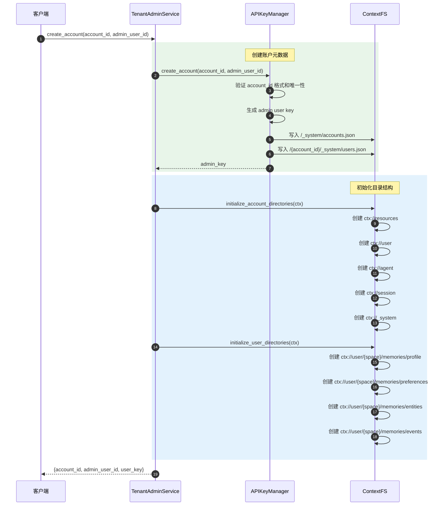

### 8.2 Session Commit

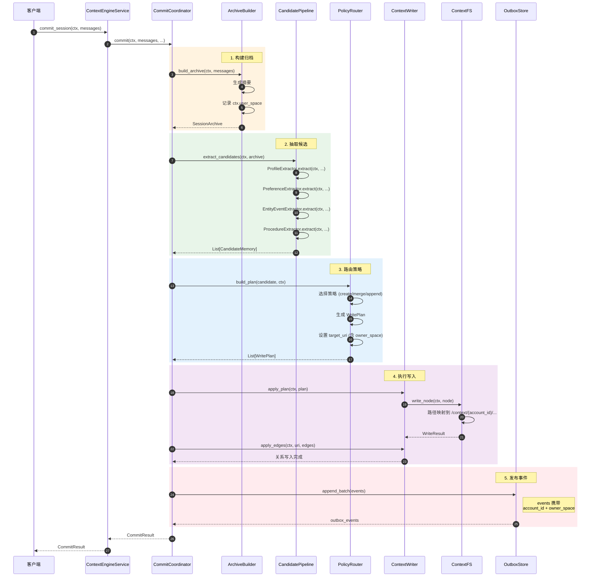

### 8.3 检索与下钻

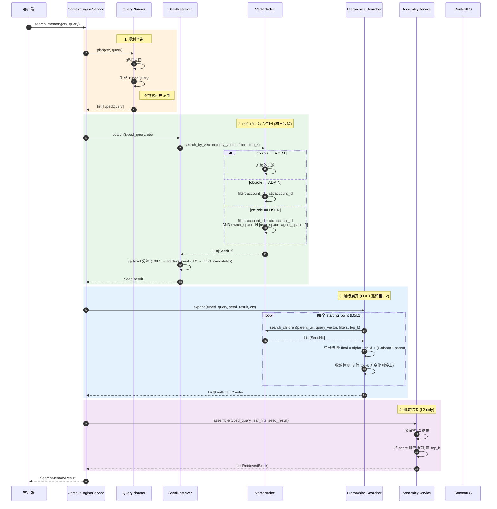

### 8.4 异步索引同步

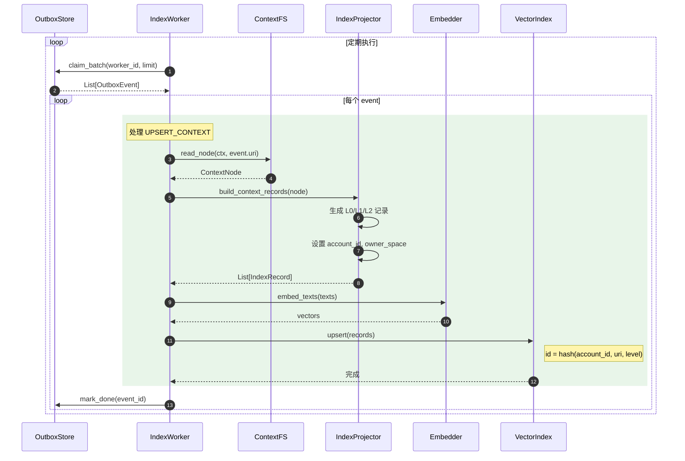

---

## 9. 错误处理

### 9.1 错误类型

| 错误类 | HTTP Code | 场景 |
|--------|-----------|------|
| `UnauthenticatedError` | 401 | 无效或缺失的 API Key |
| `PermissionDeniedError` | 403 | 角色不满足或访问越权 |
| `NotFoundError` | 404 | 资源不存在 |
| `ConflictError` | 409 | 资源已存在（如重复账户） |
| `ValidationError` | 422 | 参数格式错误 |

### 9.2 错误响应格式

```json
{
    "error": {
        "code": "PERMISSION_DENIED",
        "message": "Access denied: ctx://user/abc123/memories/profile (space not owned by current user)",
        "details": {
            "uri": "ctx://user/abc123/memories/profile",
            "required_space": "abc123",
            "current_user_space": "def456"
        }
    },
    "trace_id": "abc-123-def"
}
```

---

## 10. 配置规范

### 10.1 服务端配置

```json
{
    "server": {
        "host": "0.0.0.0",
        "port": 8080,
        "root_api_key": "your-secret-root-key",
        "cors_origins": ["*"]
    },
    "storage": {
        "fs_root": "/data/context",
        "vector_backend": "chroma",
        "vector_url": "http://localhost:8000"
    },
    "providers": {
        "embedding": {
            "type": "openai",
            "model": "text-embedding-3-small"
        },
        "llm": {
            "type": "openai",
            "model": "gpt-4o"
        }
    }
}
```

### 10.2 运行模式

| 配置 | 行为 |
|------|------|
| 不配置 `root_api_key` | Dev 模式：跳过认证，使用 default account + default user + ROOT 角色 |
| 配置 `root_api_key` | 生产模式：强制 API Key 认证，支持多 account 和多用户 |

---

## 11. 实现检查清单

### Phase 1: 控制面

- [ ] `identity.py` - Role, ResolvedIdentity, RequestContext, UserIdentifier
- [ ] `api_keys.py` - APIKeyManager（load, resolve, create/delete account, user CRUD）
- [ ] `auth.py` - AuthService（resolve_identity, build_request_context, require_role）
- [ ] `tenant_admin.py` - TenantAdminService（账户/用户生命周期）
- [ ] Admin API Router
- [ ] 单元测试：认证流程、密钥管理、RBAC

### Phase 2: 数据面

- [ ] `context_fs.py` - ContextFS 多租户改造（resolve_path, is_accessible, ensure_access）
- [ ] `vector_index.py` - VectorIndex 租户过滤（search_in_tenant, delete_account_data）
- [ ] `index_record.py` - IndexRecord 增加 account_id, owner_space
- [ ] `outbox.py` - OutboxEvent 增加 account_id
- [ ] Service 层适配（所有方法增加 ctx 参数）
- [ ] 集成测试：存储隔离、检索过滤

### Phase 3: 目录初始化与迁移

- [ ] `directories.py` - 按 account/user/agent 初始化目录
- [ ] `migrate.py` - 数据迁移脚本
- [ ] 端到端测试

---

## 12. 附录

### A. 核心对象关系图

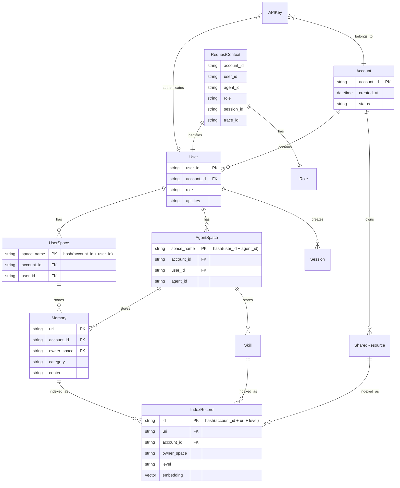

### B. 术语表

| 术语 | 定义 |
|------|------|
| Account | 顶层隔离单元，对应一个企业或租户 |
| User Space | 用户级隔离空间，由 account_id + user_id hash 得出 |
| Agent Space | Agent 级隔离空间，由 user_id + agent_id hash 得出 |
| Owner Space | 数据所有者空间，用于向量索引过滤 |
| RequestContext | 请求级上下文，贯穿全链路 |

### C. URI 示例

```
# 共享资源
ctx://resources/knowledge/intro
ctx://resources/templates/report

# 用户记忆（user_space = acme_abc12345）
ctx://user/acme_abc12345/memories/profile
ctx://user/acme_abc12345/memories/preferences/coding-style
ctx://user/acme_abc12345/memories/entities/project-alpha

# Agent 记忆（agent_space = def67890abcd）
ctx://agent/def67890abcd/memories/cases/case-001
ctx://agent/def67890abcd/memories/patterns/error-handling
ctx://agent/def67890abcd/skills/code-review

# 会话
ctx://session/acme_abc12345/sess-20260314-001
```

---

## 13. 扩展：群组协作空间 (Group Space)

> 本章描述如何扩展多租户模型以支持"多个 Agent 共享群聊记忆"的协作场景。

### 13.1 场景描述

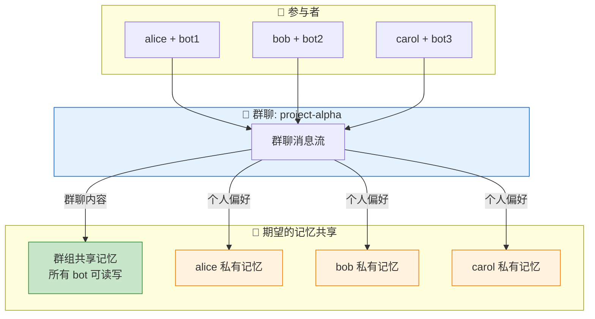

**核心需求**：
- 群聊中产生的**公共知识**（讨论结论、共识、共享文档）应被所有参与 Agent 访问
- 每个 Agent 仍保留**私有记忆**（用户个人偏好、私密信息）
- 需要支持**同账户**和**跨账户**两种协作模式

### 13.2 四维隔离模型

在原有三维模型基础上新增 **Group Space**：

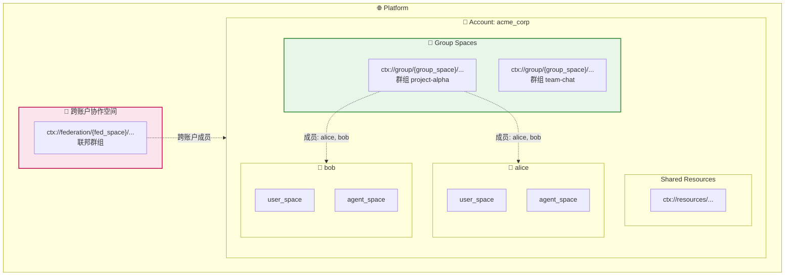

### 13.3 Group Space 数据模型

#### 13.3.1 新增对象

```python
@dataclass
class GroupIdentifier:
    """群组标识符"""
    group_id: str           # 群组唯一 ID（如 channel_id、chat_id）
    account_id: str         # 所属账户（跨账户时为 federation_id）
    group_type: str         # "channel" | "chat" | "project" | "federation"
    
    def group_space_name(self) -> str:
        """群组空间名"""
        import hashlib
        return hashlib.md5(f"{self.account_id}:{self.group_id}".encode()).hexdigest()[:12]

@dataclass
class GroupMembership:
    """群组成员关系"""
    group_id: str
    account_id: str
    user_id: str
    agent_id: str
    role: str               # "owner" | "admin" | "member" | "readonly"
    joined_at: datetime

@dataclass  
class GroupRequestContext(RequestContext):
    """群组请求上下文 - 扩展 RequestContext"""
    group: Optional[GroupIdentifier] = None  # 当前操作的群组
    
    @property
    def group_space(self) -> Optional[str]:
        return self.group.group_space_name() if self.group else None
```

#### 13.3.2 URI 扩展

| 类别 | URI 模式 | 说明 |
|------|----------|------|
| 群组记忆 | `ctx://group/{group_space}/memories/{category}/{slug}` | 群组共享记忆 |
| 群组文档 | `ctx://group/{group_space}/docs/{doc_id}` | 群组共享文档 |
| 群组会话 | `ctx://group/{group_space}/sessions/{session_id}` | 群聊会话归档 |
| 联邦群组 | `ctx://federation/{fed_space}/memories/...` | 跨账户共享 |

#### 13.3.3 存储结构

```json
// /{account_id}/_system/groups.json — 账户群组索引
{
    "groups": {
        "grp_abc123": {
            "group_id": "grp_abc123",
            "name": "project-alpha",
            "type": "channel",
            "created_at": "2026-03-14T10:00:00Z",
            "members": [
                {"user_id": "alice", "agent_id": "bot1", "role": "owner"},
                {"user_id": "bob", "agent_id": "bot2", "role": "member"}
            ]
        }
    }
}
```

### 13.4 访问控制扩展

#### 13.4.1 可见性规则矩阵（扩展）

| Scope | ROOT | ADMIN | USER (群成员) | USER (非成员) |
|-------|------|-------|---------------|---------------|
| `ctx://group/{space}/...` | 全可见 | 当前账户全可见 | 所属群组可见 | 不可见 |
| `ctx://federation/{space}/...` | 全可见 | 本账户参与的可见 | 所属联邦可见 | 不可见 |

#### 13.4.2 权限检查扩展

```python
class ContextFS:
    def is_accessible(self, ctx: RequestContext, uri: str) -> bool:
        """扩展权限检查 - 支持群组空间"""
        if ctx.role in (Role.ROOT, Role.ADMIN):
            return True
        
        # 原有逻辑：user_space / agent_space
        space_in_uri = self.extract_space(uri)
        if space_in_uri is None:
            return True
        if space_in_uri in (ctx.user_space, ctx.agent_space):
            return True
        
        # 新增：群组空间检查
        if uri.startswith("ctx://group/"):
            group_space = self._extract_group_space(uri)
            return self._is_group_member(ctx, group_space)
        
        # 新增：联邦空间检查
        if uri.startswith("ctx://federation/"):
            fed_space = self._extract_fed_space(uri)
            return self._is_federation_member(ctx, fed_space)
        
        return False
    
    def _is_group_member(self, ctx: RequestContext, group_space: str) -> bool:
        """检查用户是否为群组成员"""
        membership = self._group_store.get_membership(
            group_space=group_space,
            account_id=ctx.account_id,
            user_id=ctx.user.user_id,
        )
        return membership is not None
```

### 13.5 写入策略扩展

群聊 Session Commit 时，需要决定哪些内容写入群组空间，哪些写入私有空间：

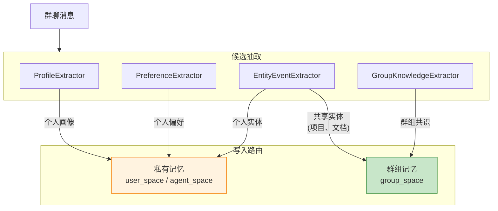

#### 13.5.1 写入策略配置

```python
@dataclass
class GroupCommitOptions:
    """群组写入选项"""
    # 群组标识
    group_id: Optional[str] = None
    
    # 写入策略
    private_categories: List[str] = field(default_factory=lambda: [
        "profile", "preference", "personal_entity"
    ])
    group_categories: List[str] = field(default_factory=lambda: [
        "group_knowledge", "shared_entity", "decision", "consensus"
    ])
    
    # 默认归属
    default_scope: str = "private"  # "private" | "group" | "ask"
```

#### 13.5.2 PolicyRouter 扩展

```python
class PolicyRouter:
    def build_plan(
        self, 
        candidate: CandidateMemory, 
        ctx: RequestContext,
        group_options: Optional[GroupCommitOptions] = None,
    ) -> WritePlan:
        """为候选选择写入策略（支持群组）"""
        
        # 判断写入目标空间
        if group_options and candidate.category in group_options.group_categories:
            # 写入群组空间
            target_space = "group"
            owner_space = ctx.group_space
            base_uri = f"ctx://group/{owner_space}/memories"
        else:
            # 写入私有空间（原有逻辑）
            target_space = "private"
            owner_space = self._resolve_private_space(candidate, ctx)
            base_uri = self._resolve_private_uri(candidate, ctx)
        
        return WritePlan(
            action=self._select_action(candidate),
            target_uri=f"{base_uri}/{candidate.category}/{candidate.routing_key}",
            owner_space=owner_space,
            target_space=target_space,
            # ...
        )
```

### 13.6 检索策略扩展

检索时需要合并私有记忆和群组记忆：

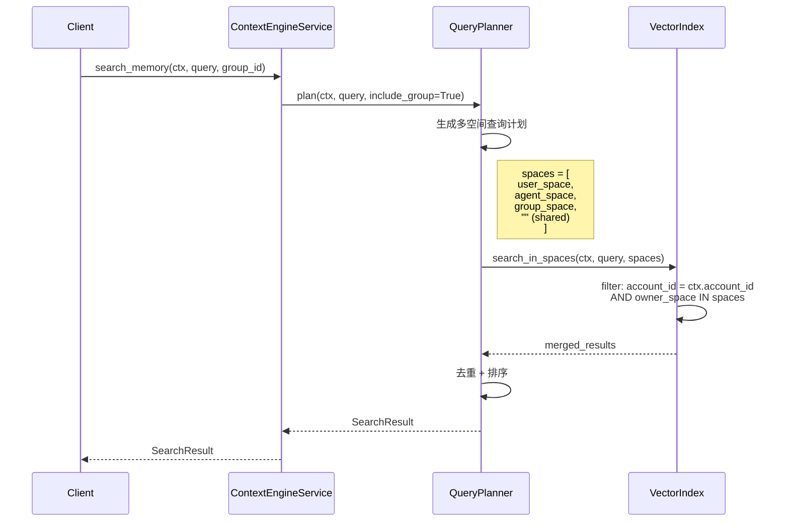

#### 13.6.1 VectorIndex 扩展

```python
class VectorIndex:
    async def search_in_spaces(
        self,
        ctx: RequestContext,
        query_vector: List[float],
        spaces: List[str],
        top_k: int = 10,
    ) -> List[SeedHit]:
        """多空间联合检索"""
        filters = {
            "account_id": ctx.account_id,
            "owner_space": {"$in": spaces}
        }
        return await self._search(query_vector, filters, top_k)
```

### 13.7 跨账户协作（Federation）

对于跨账户场景，引入 **Federation Space** 概念：

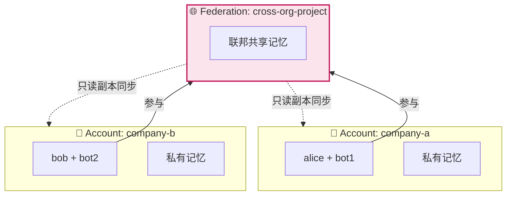

#### 13.7.1 Federation 模型

```python
@dataclass
class FederationSpace:
    """联邦空间 - 跨账户协作"""
    federation_id: str
    name: str
    owner_account_id: str       # 创建者账户
    member_accounts: List[str]  # 成员账户列表
    sync_mode: str              # "realtime" | "eventual" | "manual"
    
    def fed_space_name(self) -> str:
        import hashlib
        return hashlib.md5(self.federation_id.encode()).hexdigest()[:12]
```

#### 13.7.2 数据同步策略

| 模式 | 说明 | 适用场景 |
|------|------|----------|
| `realtime` | 实时双向同步 | 紧密协作，低延迟要求 |
| `eventual` | 最终一致性，异步同步 | 松散协作，容忍延迟 |
| `manual` | 手动同步/导出 | 敏感数据，需人工审核 |

### 13.8 API 扩展

```yaml
# 群组管理
POST   /api/v1/groups
  Request:
    group_id: string
    name: string
    type: "channel" | "chat" | "project"
    members: [{user_id, agent_id, role}]
  Response:
    group_space: string

POST   /api/v1/groups/{group_id}/members
  Request:
    user_id: string
    agent_id: string
    role: "member" | "admin"
  Response:
    membership: GroupMembership

# 群组记忆写入
POST   /api/v1/memory/commit
  Request:
    messages: [{role, content}]
    group_id: string?              # 新增：群组 ID
    group_options: GroupCommitOptions?
  Response:
    CommitResult

# 群组记忆检索
POST   /api/v1/memory/search
  Request:
    query: string
    group_id: string?              # 新增：包含群组记忆
    include_private: bool?         # 是否包含私有记忆
  Response:
    SearchResult
```

### 13.9 实现建议

| 阶段 | 内容 | 优先级 |
|------|------|--------|
| Phase 1 | 同账户群组空间（Group Space） | 高 |
| Phase 2 | 群组成员管理 + 权限检查 | 高 |
| Phase 3 | 写入路由策略 | 中 |
| Phase 4 | 多空间联合检索 | 中 |
| Phase 5 | 跨账户联邦（Federation） | 低（v2） |

### 13.10 总结

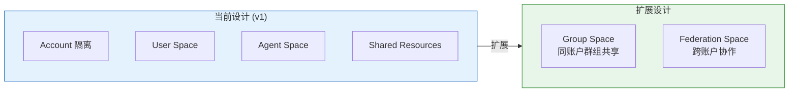

**核心要点**：
1. **Group Space** 是介于 User Space 和 Shared Resources 之间的新隔离维度
2. 通过 **成员关系表** 控制谁能访问哪个群组
3. **写入路由** 决定哪些内容进群组、哪些保持私有
4. **联合检索** 合并私有和群组记忆
5. **Federation** 解决跨账户协作（v2 考虑）

---

### D. 相关文档

- `ce_architecture.md` - ContextEngine 多租架构细化文档
- OpenViking `multi-tenant-design.md` - 多租户设计参考
- OpenClaw `routing/` - 账户路由实现参考
