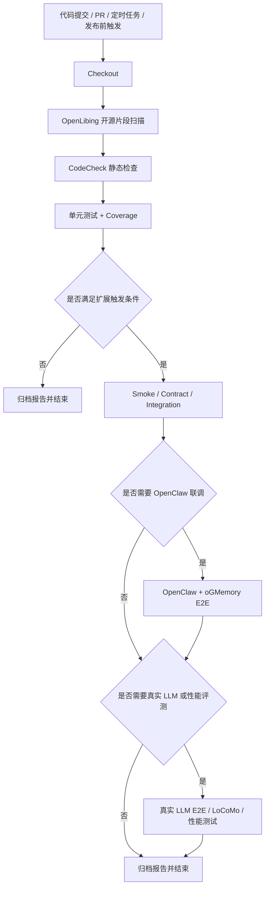
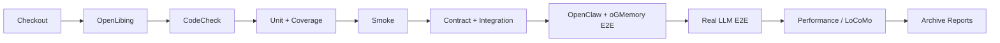
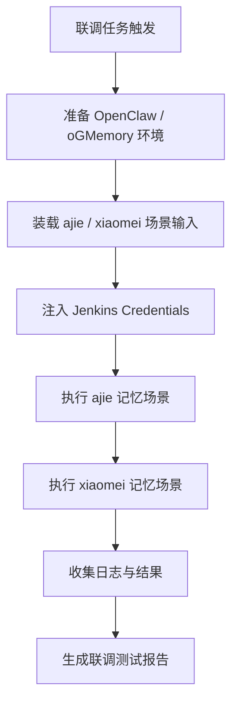
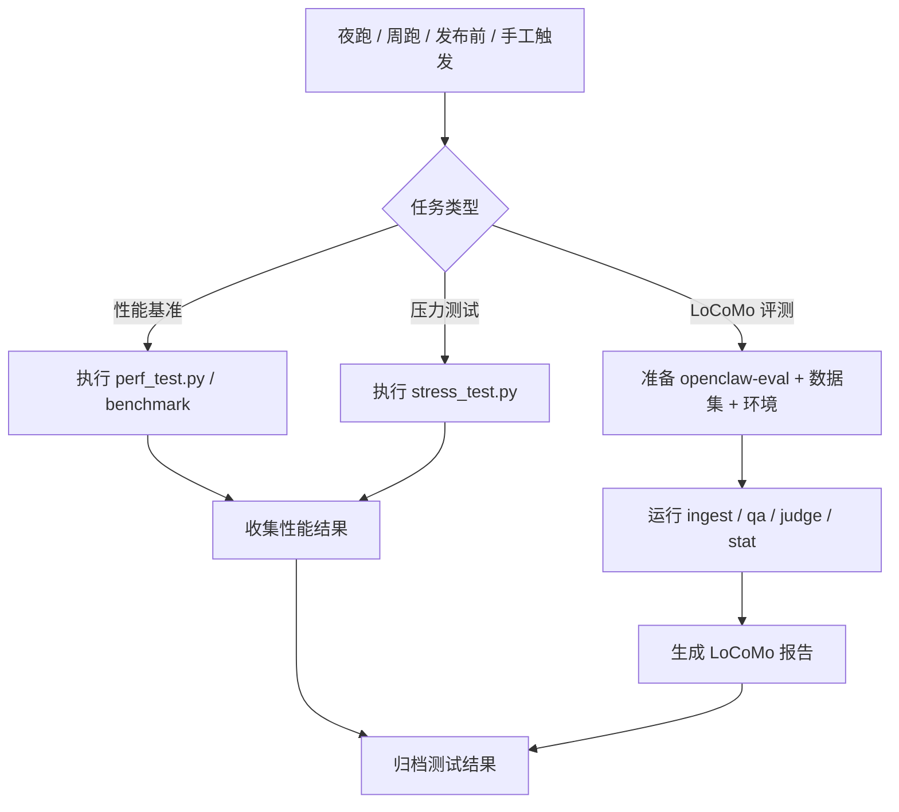
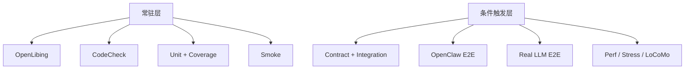

# oGMemory Jenkins 测试方案设计

## 1. 文档目标

本文档用于给 oGMemory 设计一套清晰、可落地、适合 Jenkins 管理的测试方案，重点解决以下问题：

| 目标 | 说明 |
|---|---|
| 补齐前置质量门禁 | 在跑测试前加入 OpenLibing 开源片段扫描与 CodeCheck 静态检查 |
| 引入覆盖率统计 | 在现有 `pytest` 单测基础上引入 `coverage`，并纳入 Jenkins 展示 |
| 统一测试分层 | 将 `tests/`、`scripts/`、`examples/` 中的内容按测试成本和依赖进行分类 |
| 控制高成本测试触发 | 真实大模型、OpenClaw 端到端、LoCoMo 评测不在每次提交都执行 |
| 支撑版本发布前回归 | 为夜跑、周跑、发布前构建提供完整测试矩阵 |


## 2. 当前现状

### 2.1 已知输入

| 项目 | 当前状态 |
|---|---|
| CI/CD 框架 | Jenkins |
| 已接入测试能力 | 可通过 `pytest` 跑 `tests/unit/` |
| 当前测试资产 | `tests/`、`scripts/`、`examples/` |
| 新增联调场景 | 参考 `demo-memory-ajie.py`、`demo-memory-xiaomei.py` 两个记忆场景，用 OpenClaw + oGMemory 执行 |
| 新增性能评测对象 | `openclaw-eval` 的 LoCoMo 测试 |

### 2.2 现有测试资源类型

| 目录 | 当前主要内容 | 特点 |
|---|---|---|
| `tests/unit/` | 单元测试 | 快速、稳定、适合每次提交 |
| `tests/contract/` | 契约/规则测试 | 保障核心约束不退化 |
| `tests/integration/` | 集成测试 | 验证模块间协作 |
| `tests/e2e/` | 端到端测试/评测脚本 | 更接近真实调用链路 |
| `tests/benchmark/` | 基准测试 | 关注性能回归 |
| `scripts/` | 压测、长链路、服务验证脚本 | 多为手工/专项触发 |
| `examples/` | 接入示例、冒烟示例 | 适合做 smoke 或联调示例 |

### 2.3 当前问题

| 问题 | 现状描述 | 影响 |
|---|---|---|
| 质量门禁不足 | 测试前没有统一的扫描和静态检查 | 风险发现偏晚 |
| 覆盖率不可视 | 单测执行后没有覆盖率数据 | 无法衡量测试充分性 |
| 测试混杂 | `tests/`、`scripts/`、`examples/` 的角色边界不清晰 | 难以设计稳定流水线 |
| 高成本测试缺乏触发规则 | 真实 LLM、联调、性能评测未分层 | 容易让 CI 变慢、不稳定 |
| 联调资产未纳管 | OpenClaw 场景示例未统一接入 | 难以形成完整回归链路 |


## 3. 总体方案

### 3.1 测试分层总览

| 测试层级 | 主要内容 | 是否调用真实大模型 | 是否依赖外部服务 | 是否默认每次提交执行 |
|---|---|---:|---:|---:|
| L1 质量门禁层 | OpenLibing、CodeCheck | 否 | 否 | 是 |
| L2 快速回归层 | 单元测试、覆盖率、轻量 smoke | 否 | 少量/可 mock | 是 |
| L3 集成验证层 | contract、integration、非真实 LLM e2e | 否 | 是 | 否 |
| L4 联调验收层 | OpenClaw + oGMemory 端到端 | 可选 | 是 | 否 |
| L5 性能评测层 | perf、stress、LoCoMo | 可选 | 是 | 否 |

### 3.2 总体流程图



### 3.3 分层设计原则

| 原则 | 说明 |
|---|---|
| 快慢分离 | 快速、稳定、确定性高的测试常驻；高成本测试条件触发 |
| 风险前移 | 开源片段扫描、静态检查放在测试前 |
| 自身测试与联调测试分离 | 先验证 oGMemory 本身，再验证 OpenClaw 接入 |
| 功能与性能分离 | 功能回归与性能评测不混跑 |
| 可配置、可扩展 | 通过 Jenkins 参数、标签、定时任务实现差异化触发 |


## 4. Jenkins 流水线设计

### 4.1 推荐阶段设计

| 阶段序号 | Stage 名称 | 目标 | 默认执行 |
|---|---|---|---:|
| 1 | `Checkout` | 拉取代码、准备环境 | 是 |
| 2 | `OpenLibing Scan` | 开源片段扫描 | 是 |
| 3 | `CodeCheck` | 静态检查 | 是 |
| 4 | `Unit Test + Coverage` | 跑核心单测并统计覆盖率 | 是 |
| 5 | `Smoke Test` | 跑最轻量的示例和 mock 长链路 | 是 |
| 6 | `Contract + Integration` | 跑契约和非真实 LLM 集成测试 | 否 |
| 7 | `OpenClaw + oGMemory E2E` | 联调验收 | 否 |
| 8 | `Real LLM E2E` | 跑真实模型验证 | 否 |
| 9 | `Performance / LoCoMo` | 跑性能测试和 LoCoMo 评测 | 否 |
| 10 | `Archive Reports` | 归档报告、日志、覆盖率、评测结果 | 是 |

### 4.2 推荐流水线图



### 4.3 默认与条件执行关系

| 阶段 | 默认 PR | 主干合入 | 夜跑 | 周跑/发布前 |
|---|---:|---:|---:|---:|
| OpenLibing | 是 | 是 | 是 | 是 |
| CodeCheck | 是 | 是 | 是 | 是 |
| Unit + Coverage | 是 | 是 | 是 | 是 |
| Smoke | 是 | 是 | 是 | 是 |
| Contract + Integration | 否 | 是 | 是 | 是 |
| OpenClaw + oGMemory E2E | 否 | 否/可选 | 是 | 是 |
| Real LLM E2E | 否 | 否 | 是 | 是 |
| Performance / LoCoMo | 否 | 否 | 可选 | 是 |


## 5. 前置质量门禁设计

### 5.1 OpenLibing 开源片段扫描

| 项目 | 设计建议 |
|---|---|
| 位置 | 流水线最前面，在测试前执行 |
| 实现方式 | 通过 OpenLibing 平台接入 Jenkins |
| 目的 | 识别开源片段风险、许可证风险、合规风险 |
| 失败策略 | 扫描失败直接阻断后续测试 |
| 触发方式 | PR、主干提交、夜跑、发布前全部执行 |
| 输出物 | 扫描报告链接、风险摘要 |

### 5.2 CodeCheck 静态检查

| 项目 | 设计建议 |
|---|---|
| 位置 | OpenLibing 之后，单测之前 |
| 实现方式 | 通过 OpenLibing 平台执行 CodeCheck |
| 检查范围 | 主代码目录 + `tests/` + `scripts/` + `examples/` |
| 目的 | 尽早发现语法、风格、潜在缺陷、坏味道 |
| 失败策略 | 严重问题阻断流水线 |
| 触发方式 | PR、主干提交、夜跑、发布前全部执行 |


## 6. 单元测试与覆盖率设计

### 6.1 范围设计

| 分类 | 建议纳入范围 |
|---|---|
| 必跑单测 | `tests/unit/**` |
| 必跑补充项 | `tests/test_assemble_prompt.py` |
| 暂不纳入此层 | `tests/integration/**`、`tests/e2e/**`、真实 LLM 场景 |

### 6.2 推荐执行命令

```bash
coverage erase
coverage run -m pytest tests/unit tests/test_assemble_prompt.py -v
coverage report -m
coverage xml -o reports/coverage.xml
coverage html -d reports/coverage_html
```

### 6.3 覆盖率策略

| 阶段 | 覆盖率策略 | 说明 |
|---|---|---|
| 第一阶段 | 先统计，不强卡高阈值 | 先建立基线 |
| 第二阶段 | 总覆盖率门禁 | 建议先从 `>= 60%` 开始 |
| 第三阶段 | 提高总覆盖率 | 建议提升到 `>= 70%` |
| 第四阶段 | 关键模块单独考核 | 对高风险模块设子阈值 |

### 6.4 关键模块覆盖率建议

| 模块 | 建议重点关注原因 |
|---|---|
| `service/` | 写入/读取 API 是主业务入口 |
| `retrieval/` | 直接影响检索效果与记忆召回 |
| `index/` | 影响索引构建、outbox、异步处理 |
| `fs/` | 影响存储和 URI 访问规则 |
| `session/` | 影响 session 生命周期管理 |
| `providers/` | 影响 LLM、Embedding、Index 适配 |

### 6.5 Jenkins 报告产物

| 报告 | 用途 | Jenkins 建议 |
|---|---|---|
| `coverage.xml` | 机器可读覆盖率结果 | 接入 Coverage/Cobertura 插件 |
| `coverage_html/` | 人工查看覆盖率详情 | 作为构建归档物 |
| `pytest` 测试结果 | 失败用例与趋势 | 统一收集 JUnit XML |


## 7. 测试资产分类设计

### 7.1 分类维度

| 维度 | 说明 |
|---|---|
| 是否真实调用大模型 | 决定成本和稳定性 |
| 是否依赖外部服务 | 决定环境复杂度 |
| 是否只验证 oGMemory 本身 | 决定是否进入默认回归 |
| 是否依赖 OpenClaw | 决定是否归为联调层 |
| 是否属于性能评测 | 决定是否做条件触发 |

### 7.2 现有内容分类表

| 分类编号 | 分类名称 | 典型用例/脚本 | 归属对象 | 默认执行 | 备注 |
|---|---|---|---|---:|---|
| A | 核心快速测试 | `tests/unit/**`、`tests/test_assemble_prompt.py` | oGMemory | 是 | 单测主集合 |
| B | 轻量 Smoke | `examples/basic_usage.py`、`scripts/run_e2e_long_context_mock.py` | oGMemory | 是 | 不调用真实 LLM |
| C | 契约与非 LLM 集成 | `tests/contract/**`、`tests/integration/**`、`tests/e2e/test_session_lifecycle.py` | oGMemory | 否 | 合入主干/夜跑 |
| D | OpenClaw 联调 | `tests/integration/test_openclaw_plugin.py`、ajie/xiaomei 场景 | 联调 | 否 | 需要 OpenClaw 环境 |
| E | 真实 LLM 回归 | `scripts/run_e2e_long_context_real.py`、`examples/claude_code_integration.py` | 联调 | 否 | 高成本 |
| F | 性能测试 | `scripts/perf_test.py`、`scripts/stress_test.py`、`tests/benchmark/**` | oGMemory | 否 | 夜跑/发布前 |
| G | LoCoMo 评测 | `openclaw-eval` + LoCoMo 数据集 | 联调/性能 | 否 | 周期性执行 |


## 8. oGMemory 自身测试与 OpenClaw 联调测试拆分

### 8.1 分类总表

| 测试大类 | 包含内容 | 是否依赖 OpenClaw | 建议执行阶段 |
|---|---|---:|---|
| oGMemory 自身测试 | unit、contract、大部分 integration、mock e2e、perf/stress | 否 | 默认回归 + 夜跑 |
| OpenClaw 联调测试 | plugin 集成、真实链路、记忆场景 demo | 是 | 联调专项、夜跑、发布前 |

### 8.2 oGMemory 自身测试清单

| 类型 | 典型内容 |
|---|---|
| 单元测试 | `tests/unit/**` |
| 契约测试 | `tests/contract/**` |
| 非真实模型集成 | 大部分 `tests/integration/**` |
| Mock 长链路 | `scripts/run_e2e_long_context_mock.py` |
| 轻量示例 | `examples/basic_usage.py` |
| 性能脚本 | `scripts/perf_test.py`、`scripts/stress_test.py` |

### 8.3 OpenClaw 联调测试清单

| 类型 | 典型内容 |
|---|---|
| OpenClaw 插件测试 | `tests/integration/test_openclaw_plugin.py` |
| 真实大模型长链路 | `scripts/run_e2e_long_context_real.py` |
| 接入示例 | `examples/claude_code_integration.py` |
| OpenClaw 记忆场景示例 | `demo-memory-ajie.py`、`demo-memory-xiaomei.py` 对应场景 |


## 9. `demo-memory-ajie.py` / `demo-memory-xiaomei.py` 场景接入方案

### 9.1 新增示例

| 来源 | 路径 |
|---|---|

说明：这里的目标是复用这两个示例的业务场景，使用当前的 OpenClaw + oGMemory 环境执行对应验证。

### 9.2 接入原则

| 原则 | 设计建议 |
|---|---|
| 场景复用 | 参考 `ajie` / `xiaomei` 用例的输入输出模式，在本仓或 Jenkins 脚本中复刻执行 |
| 不进入默认 PR 流水线 | 归类为 OpenClaw 联调验收测试 |
| 脚本统一封装 | 建议新增本仓测试脚本，统一调用 OpenClaw + oGMemory 接口执行场景 |
| 凭据集中管理 | OpenClaw Token、模型密钥通过 Jenkins Credentials 注入 |

### 9.3 接入流程图



### 9.4 建议触发方式

| 触发场景 | 是否执行 ajie/xiaomei 场景 |
|---|---:|
| 普通 PR | 否 |
| 带 `run-openclaw-e2e` 标签的 PR | 是 |
| 主干夜跑 | 是 |
| 发布前 | 是 |
| 手工参数化触发 | 是 |


## 10. 真实大模型测试设计

### 10.1 不建议每次提交都执行的原因

| 风险点 | 影响 |
|---|---|
| 成本高 | 消耗 API 费用 |
| 耗时长 | 拉长 PR 反馈时间 |
| 波动性 | 模型输出可能带来非确定性 |
| 依赖外部网络与密钥 | 容易因环境问题导致假失败 |

### 10.2 真实 LLM 测试触发条件

| 触发条件 | 建议执行 |
|---|---:|
| 普通 PR | 否 |
| PR 带 `run-real-llm` 标签 | 是 |
| Jenkins 参数 `RUN_REAL_LLM=true` | 是 |
| 主干夜跑 | 是 |
| 发布前构建 | 是 |

### 10.3 目录变更触发建议

| 目录/文件变更 | 是否建议自动触发真实 LLM 回归 |
|---|---:|
| `openclaw_context_engine_plugin/` | 是 |
| `retrieval/` | 是 |
| `service/` | 是 |
| `providers/llm/` | 是 |
| `examples/claude_code_integration.py` | 是 |
| `scripts/run_e2e_long_context_real.py` | 是 |

### 10.4 环境依赖表

| 依赖项 | 用途 |
|---|---|
| `OPENAI_API_KEY` 或其他模型密钥 | 调用真实模型 |
| OpenClaw 服务 | 联调验证 |
| AGFS 服务 | 存储依赖 |
| Jenkins Credentials | 安全管理敏感配置 |


## 11. 性能测试与 LoCoMo 评测设计

### 11.1 性能测试分类

| 分类 | 典型内容 | 目标 |
|---|---|---|
| 模块级基准测试 | `scripts/perf_test.py` | 测单写、批量写、检索、embedding、merge 延迟 |
| 压力测试 | `scripts/stress_test.py` | 测并发写入、merge 一致性、outbox 压力 |
| 基准回归 | `tests/benchmark/**` | 防止性能退化 |
| LoCoMo 评测 | `openclaw-eval` | 测多轮记忆效果与问答质量 |

### 11.2 LoCoMo 评测接入建议

| 项目 | 设计建议 |
|---|---|
| 评测工具 | `https://github.com/ZaynJarvis/openclaw-eval` |
| 数据集 | LoCoMo |
| 用途 | 验证记忆系统在多轮会话中的实际问答表现 |
| 执行位置 | 单独 Jenkins Job，不和普通 PR 流水线强绑定 |
| 产出 | 准确率、耗时、token 成本、版本对比结果 |

### 11.3 LoCoMo 触发条件

| 触发场景 | 是否执行 |
|---|---:|
| 普通 PR | 否 |
| PR 带 `run-locomo-eval` 标签 | 是 |
| 每周定时任务 | 是 |
| 发布前 | 是 |
| Jenkins 手工触发 | 是 |

### 11.4 LoCoMo 输出指标

| 指标 | 说明 |
|---|---|
| QA 准确率 | 回答是否命中正确记忆 |
| 分类维度准确率 | 不同问题类别的表现 |
| 输入 token | 成本观察 |
| 输出 token | 成本观察 |
| 总 token | 总体资源消耗 |
| 单条样本耗时 | 性能观察 |
| 与基线版本差异 | 回归判断 |

### 11.5 性能/LoCoMo 触发流程




## 12. pytest marker 与标签治理建议

### 12.1 推荐 marker

| marker | 含义 |
|---|---|
| `unit` | 单元测试 |
| `smoke` | 轻量 smoke |
| `contract` | 契约测试 |
| `integration` | 集成测试 |
| `e2e` | 端到端测试 |
| `openclaw` | OpenClaw 联调 |
| `real_llm` | 真实大模型测试 |
| `performance` | 性能测试 |
| `locomo` | LoCoMo 评测 |

### 12.2 推荐执行组合

| 场景 | 建议命令 |
|---|---|
| PR 默认流水线 | `pytest -m "unit or smoke" tests` |
| 主干合入/夜跑 | `pytest -m "unit or smoke or contract or integration" tests` |
| OpenClaw 联调 | `pytest -m "openclaw or e2e" tests` |
| 真实模型回归 | `pytest -m "real_llm" tests` |

### 12.3 `scripts/` 与 `examples/` 的治理建议

| 类型 | 当前状态 | 后续建议 |
|---|---|---|
| `scripts/` | 多为脚本，非 pytest 用例 | 用 Jenkins shell step 调用，后续可加 pytest wrapper |
| `examples/` | 多为示例脚本 | 将关键示例包装成 smoke/integration 用例 |


## 13. Jenkins 触发矩阵

### 13.1 测试场景触发方式总表

| 测试场景 | 典型内容 | 默认 PR 自动触发 | PR 标签触发 | PR 指令触发 | 定时触发 | 发布前触发 | Jenkins 手工参数触发 |
|---|---|---:|---|---|---:|---:|---:|
| 质量门禁 | OpenLibing 开源片段扫描、CodeCheck 静态检查 | 是 | 否 | `/retest` | 是 | 是 | 是 |
| 核心单元测试 | `tests/unit/**`、`tests/test_assemble_prompt.py` | 是 | 否 | `/retest` | 是 | 是 | 是 |
| 覆盖率统计 | `coverage + pytest` | 是 | 否 | `/retest` | 是 | 是 | 是 |
| 轻量 Smoke | `examples/basic_usage.py`、`scripts/run_e2e_long_context_mock.py` | 是 | 否 | `/retest smoke` | 是 | 是 | 是 |
| 契约测试 | `tests/contract/**` | 否 | `run-contract` | `/retest contract` | 是 | 是 | 是 |
| 非真实 LLM 集成测试 | `tests/integration/**`、`tests/e2e/test_session_lifecycle.py` | 否 | `run-integration` | `/retest integration` | 是 | 是 | 是 |
| OpenClaw 联调测试 | `tests/integration/test_openclaw_plugin.py`、ajie/xiaomei 场景 | 否 | `run-openclaw-e2e` | `/retest openclaw` | 是 | 是 | 是 |
| 真实 LLM 回归 | `scripts/run_e2e_long_context_real.py`、`examples/claude_code_integration.py` | 否 | `run-real-llm` | `/retest real-llm` | 是 | 是 | 是 |
| 基准性能测试 | `tests/benchmark/**`、`scripts/perf_test.py` | 否 | `run-perf`、`run-benchmark` | `/retest perf` | 是 | 是 | 是 |
| 压力测试 | `scripts/stress_test.py` | 否 | `run-stress` | `/retest stress` | 可选 | 是 | 是 |
| LoCoMo 评测 | `openclaw-eval` | 否 | `run-locomo-eval` | `/retest locomo` | 是 | 是 | 是 |
| 全量专项回归 | OpenClaw + Real LLM + Perf + LoCoMo | 否 | `run-full-performance` | `/retest full` | 周跑可选 | 是 | 是 |

### 13.2 推荐标签与指令映射

| 类型 | 名称 | 触发内容 |
|---|---|---|
| PR 标签 | `run-contract` | 契约测试 |
| PR 标签 | `run-integration` | 非真实 LLM 集成测试 |
| PR 标签 | `run-openclaw-e2e` | OpenClaw 联调测试 |
| PR 标签 | `run-real-llm` | 真实 LLM 回归 |
| PR 标签 | `run-perf` | 基准性能测试 |
| PR 标签 | `run-benchmark` | Benchmark 回归 |
| PR 标签 | `run-stress` | 压力测试 |
| PR 标签 | `run-locomo-eval` | LoCoMo 评测 |
| PR 标签 | `run-full-performance` | 全量专项回归 |
| PR 指令 | `/retest` | 重跑默认流水线 |
| PR 指令 | `/retest smoke` | 重跑默认流水线并补跑 smoke |
| PR 指令 | `/retest contract` | 跑契约测试 |
| PR 指令 | `/retest integration` | 跑非真实 LLM 集成测试 |
| PR 指令 | `/retest openclaw` | 跑 OpenClaw 联调测试 |
| PR 指令 | `/retest real-llm` | 跑真实 LLM 回归 |
| PR 指令 | `/retest perf` | 跑性能基准测试 |
| PR 指令 | `/retest stress` | 跑压力测试 |
| PR 指令 | `/retest locomo` | 跑 LoCoMo 评测 |
| PR 指令 | `/retest full` | 跑完整专项回归 |

### 13.3 推荐规则

| 规则 | 说明 |
|---|---|
| 默认 PR 流水线只执行低成本测试 | 默认只跑质量门禁、单元测试、覆盖率统计和轻量 smoke |
| 高成本测试采用多入口触发 | 契约、集成、OpenClaw、真实 LLM、性能、LoCoMo 均支持标签、指令、定时、发布前触发 |
| 指令用于补跑和临时加跑 | `/retest` 更适合处理环境波动、偶发失败、review 阶段补测 |
| 标签用于声明持续加跑范围 | 若某个 PR 在后续多次 push 中都需附带专项测试，可使用标签 |
| 发布前触发不依赖标签和指令 | 发布前构建按发布门禁直接执行完整回归集 |

| 触发场景 | OpenLibing | CodeCheck | Unit+Coverage | Smoke | Contract/Integration | OpenClaw 联调 | Real LLM | Perf/LoCoMo |
|---|---:|---:|---:|---:|---:|---:|---:|---:|
| 普通 PR | 是 | 是 | 是 | 是 | 否 | 否 | 否 | 否 |
| PR + `run-openclaw-e2e` | 是 | 是 | 是 | 是 | 是 | 是 | 否 | 否 |
| PR + `run-real-llm` | 是 | 是 | 是 | 是 | 是 | 是 | 是 | 否 |
| PR + `run-locomo-eval` | 是 | 是 | 是 | 是 | 是 | 是 | 可选 | 是 |
| 主干合入 | 是 | 是 | 是 | 是 | 是 | 可选 | 否 | 否 |
| 每日夜跑 | 是 | 是 | 是 | 是 | 是 | 是 | 是 | 可选 |
| 每周回归 | 是 | 是 | 是 | 是 | 是 | 是 | 是 | 是 |
| 发布前 | 是 | 是 | 是 | 是 | 是 | 是 | 是 | 是 |


## 14. 落地实施路线

### 14.1 分阶段落地表

| 阶段 | 目标 | 主要动作 |
|---|---|---|
| 阶段 1 | 补齐质量门禁 | 接入 OpenLibing、CodeCheck、coverage |
| 阶段 2 | 完成测试分层 | 给 pytest 用例补 marker，梳理 smoke/default/conditional 集合 |
| 阶段 3 | 接入联调链路 | 增加 OpenClaw 独立 Stage 或 Job，接入 `ajie`、`xiaomei` 记忆场景 |
| 阶段 4 | 接入性能评测 | 增加 perf/stress 任务和 `openclaw-eval` LoCoMo 任务 |
| 阶段 5 | 建立发布门禁 | 将夜跑、周跑、发布前回归统一纳入质量基线 |

### 14.2 建议优先级

| 优先级 | 事项 |
|---|---|
| P0 | OpenLibing、CodeCheck、Unit + Coverage |
| P1 | Smoke 分类与执行 |
| P1 | Contract/Integration 分层 |
| P2 | OpenClaw 联调接入 |
| P2 | 真实 LLM 测试条件触发 |
| P3 | LoCoMo 评测平台化 |


## 15. 最终推荐结构

### 15.1 推荐结构总览

| 层级 | 常驻/条件 | 组成 |
|---|---|---|
| 第一层 | 常驻 | OpenLibing + CodeCheck |
| 第二层 | 常驻 | Unit + Coverage + Smoke |
| 第三层 | 条件 | Contract + Integration |
| 第四层 | 条件 | OpenClaw E2E + Real LLM |
| 第五层 | 条件 | Perf + Stress + LoCoMo |

### 15.2 最终建议



| 结论 | 说明 |
|---|---|
| 默认流水线要快 | 让普通提交通常只经过常驻层 |
| 高成本测试要精确触发 | 联调、真实 LLM、LoCoMo 不应每次提交都跑 |
| 自身测试优先级高于联调测试 | 先保证 oGMemory 本身稳定，再看接入链路 |
| 报告必须归档 | 覆盖率、联调日志、LoCoMo 结果都要可追溯 |


## 16. 参考链接

| 类型 | 链接 |
|---|---|
| openclaw-eval | https://github.com/ZaynJarvis/openclaw-eval |
